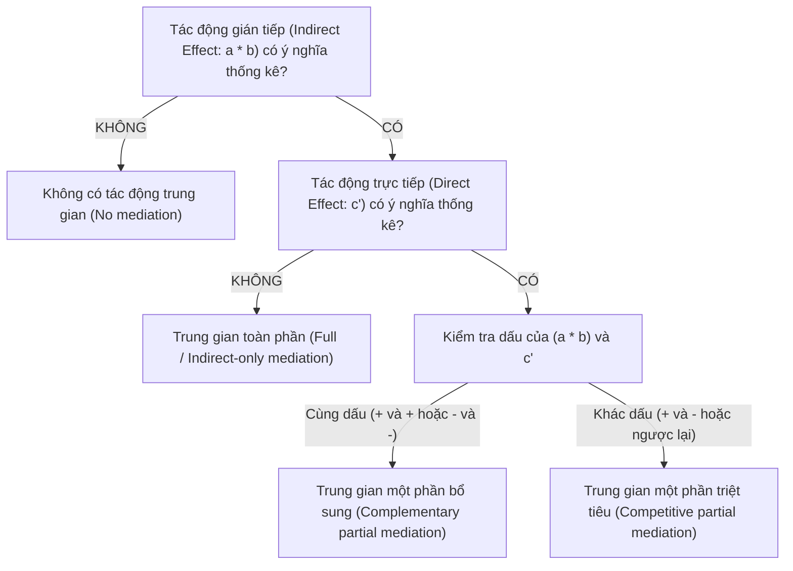

# CẨM NANG PHÂN TÍCH MÔ HÌNH CẤU TRÚC TUYẾN TÍNH (SEM)
*(Structural Equation Modeling Guide: CB-SEM vs PLS-SEM)*

---

## 1. SO SÁNH GIỮA CB-SEM VÀ PLS-SEM

Trong ngành Marketing và Quản trị kinh doanh, hai trường phái SEM chính được áp dụng:

| Tiêu chí so sánh | CB-SEM (Covariance-Based SEM) | PLS-SEM (Partial Least Squares SEM) |
| :--- | :--- | :--- |
| **Phần mềm tiêu biểu** | AMOS, LISREL, R (`lavaan`), Mplus | SmartPLS 4, R (`cSEM`, `seminr`), ADANCO |
| **Mục tiêu nghiên cứu** | Kiểm định và xác nhận lý thuyết (Theory confirmation) | Phát triển lý thuyết và dự báo (Theory development & Prediction) |
| **Mô hình cấu trúc** | Mô hình vừa phải, ít biến tiềm ẩn | Mô hình phức tạp (Nhiều bậc, nhiều biến trung gian/điều tiết) |
| **Yêu cầu về phân phối** | Phân phối chuẩn đa biến (Multivariate Normality) nghiêm ngặt | Phi tham số (Non-parametric), không đòi hỏi phân phối chuẩn |
| **Cỡ mẫu yêu cầu** | Lớn ($N > 300 - 500$) | Linh hoạt ($N > 150 - 300$), xử lý tốt mẫu vừa và nhỏ |
| **Chỉ số đánh giá mô hình** | Chi-square, RMSEA, CFI, TLI, GFI, SRMR | $R^2$, $f^2$, $Q^2_{predict}$, SRMR, HTMT |

> **Khuyến nghị cho Luận án Tiến sĩ**:
> Nếu đề tài tập trung vào bối cảnh mới (ví dụ: AI marketing, hành vi tiêu dùng số, năng lực số), có mô hình phức tạp với cả biến trung gian và biến điều tiết, **PLS-SEM là lựa chọn chiếm ưu thế** và được các tạp chí hàng đầu chấp thuận rộng rãi (theo Hair et al., 2019, 2022).

---

## 2. BẢNG TIÊU CHUẨN ĐÁNH GIÁ MÔ HÌNH ĐO LƯỜNG (OUTER MODEL)

| Chỉ số (Metric) | Ký hiệu | Ngưỡng chấp nhận (Threshold) | Tài liệu trích dẫn chuẩn |
| :--- | :---: | :---: | :--- |
| **Hệ số tải ngoài (Outer Loadings)** | $\lambda$ | $\ge 0.708$ (chấp nhận từ $0.40 - 0.70$ nếu AVE $\ge 0.50$) | Hair et al. (2019) |
| **Độ tin cậy Cronbach's Alpha** | $\alpha$ | $\ge 0.70$ | Nunnally & Bernstein (1994) |
| **Độ tin cậy tổng hợp (Composite Reliability)** | $\text{CR}$ | $0.70 \le \text{CR} \le 0.95$ | Hair et al. (2022) |
| **Phương sai trích trung bình (Convergent Validity)** | $\text{AVE}$ | $\ge 0.50$ | Fornell & Larcker (1981) |
| **Tỷ số HTMT (Discriminant Validity)** | $\text{HTMT}$ | $< 0.85$ (nghiêm ngặt) hoặc $< 0.90$ (chấp nhận được) | Henseler et al. (2015) |
| **Tiêu chuẩn Fornell-Larcker** | $\sqrt{\text{AVE}}$ | $\sqrt{\text{AVE}}$ của biến phải lớn hơn tương quan với các biến khác | Fornell & Larcker (1981) |

---

## 3. BẢNG TIÊU CHUẨN ĐÁNH GIÁ MÔ HÌNH CẤU TRÚC (INNER MODEL)

| Bước kiểm định | Chỉ số đo lường | Tiêu chuẩn đánh giá |
| :--- | :--- | :--- |
| **1. Đa cộng tuyến (Collinearity)** | $\text{VIF}$ nội tại (Inner VIF) | $\text{VIF} < 3.0$ (lý tưởng), $\text{VIF} < 5.0$ (chấp nhận) |
| **2. Hệ số giải thích ($R^2$)** | $R^2$ của các biến nội sinh | $0.25$ (Yếu), $0.50$ (Vừa), $0.75$ (Mạnh) |
| **3. Mức độ tác động ($f^2$)** | Effect size $f^2$ | $0.02$ (Nhỏ), $0.15$ (Trung bình), $0.35$ (Lớn) |
| **4. Ý nghĩa thống kê giả thuyết** | $t$-value, $p$-value, 95% Bootstrapping CI | $t > 1.96$ ($p < 0.05$), $t > 2.58$ ($p < 0.01$). Khoảng tin cậy 95% không chứa số 0. |
| **5. Năng lực dự báo ngoài mẫu** | $Q^2_{predict}$ (PLS-Predict) | So sánh RMSE của PLS với LM (Linear Model benchmark). Nếu hầu hết chỉ báo có $\text{RMSE}_{PLS} < \text{RMSE}_{LM} \rightarrow$ Năng lực dự báo cao. |

---

## 4. QUY TRÌNH KIỂM ĐỊNH TÁC ĐỘNG TRUNG GIAN (MEDIATION PROCEDURE)
Áp dụng phương pháp phân tích trung gian của Zhao et al. (2010) và Hair et al. (2022) qua Bootstrapping:

