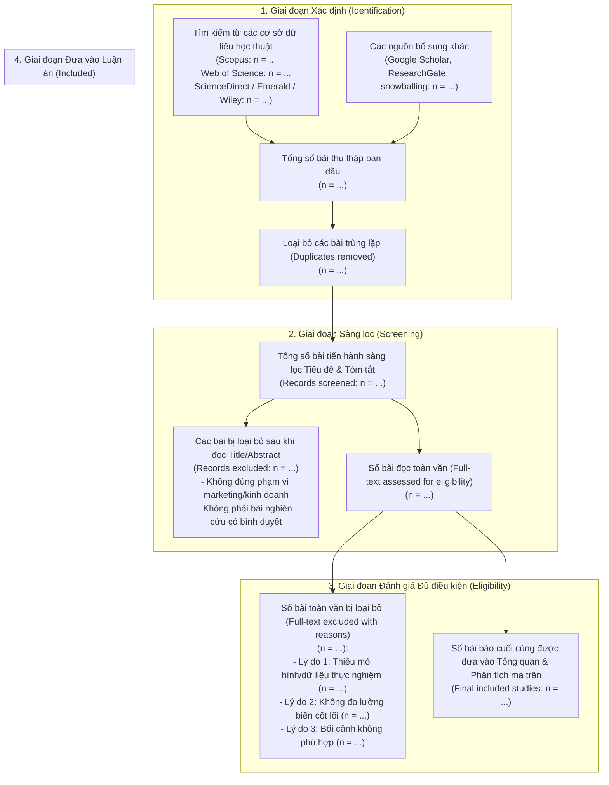

# QUY TRÌNH TỔNG QUAN TÀI LIỆU HỆ THỐNG THEO CHUẨN PRISMA 2020
*(Preferred Reporting Items for Systematic Reviews and Meta-Analyses)*

---

## 1. SƠ ĐỒ DÒNG CHẢY PRISMA 2020 (PRISMA FLOW DIAGRAM)

---

## 2. BẢNG TIÊU CHÍ LỰA CHỌN VÀ LOẠI TRỪ (ELIGIBILITY CRITERIA)

| Tiêu chí (Criterion) | Tiêu chuẩn Lựa chọn (Inclusion Criteria) | Tiêu chuẩn Loại trừ (Exclusion Criteria) |
| :--- | :--- | :--- |
| **Loại tài liệu** | Bài báo nghiên cứu gốc (Original empirical articles), Tổng quan hệ thống (Systematic reviews) trên tạp chí có phản biện khoa học (Peer-reviewed journals). | Kỷ yếu hội thảo tóm tắt, sách, bình luận xã luận (Editorials), luận văn chưa công bố, báo cáo kỹ thuật. |
| **Xếp hạng tạp chí** | Tạp chí thuộc Scopus (Q1/Q2/Q3), Web of Science (SSCI/ESCI), hoặc danh mục ABS/AJG (2, 3, 4, 4*), ABDC (B, A, A*). | Tạp chí kém chất lượng (Predatory journals), tạp chí không có chỉ số trích dẫn. |
| **Khung thời gian** | 5 - 10 năm gần nhất (ví dụ: 2015 - 2026), cộng với các công trình kinh điển đặt nền móng. | Các bài quá cũ không còn phù hợp với bối cảnh kinh tế số/công nghệ mới (trừ các bài lý thuyết nền). |
| **Ngôn ngữ** | Tiếng Anh và Tiếng Việt. | Các ngôn ngữ khác không thể dịch hoặc thẩm định độ tin cậy. |
| **Nội dung chủ đề** | Nghiên cứu tập trung vào mối quan hệ giữa các biến số về hành vi người tiêu dùng, marketing, chuyển đổi số, năng lực doanh nghiệp. | Các bài thuần túy về thuật toán tin học, kỹ thuật phần cứng, không chứa các biến số hành vi/quản trị. |
