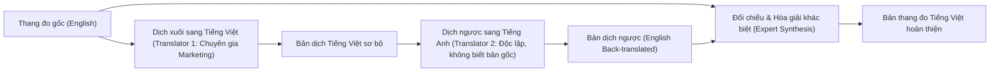

# QUY TRÌNH PHÁT TRIỂN VÀ THÍCH ỨNG THANG ĐO TRONG MARKETING
*(Scale Adaptation & Operationalization Protocol)*

---

## 1. NGUYÊN TẮC KẾ THỪA VÀ ĐIỀU CHỈNH THANG ĐO CHUẨN

Trong nghiên cứu tiến sĩ Marketing & Quản trị kinh doanh, việc tự sáng tạo thang đo mới mà không có quy trình định tính nghiêm ngặt thường bị hội đồng đánh giá thấp. Phương pháp tối ưu và chuẩn mực là **kế thừa thang đo đã được kiểm định (validated scales)** từ các công trình quốc tế uy tín và thích ứng vào bối cảnh Việt Nam.

### Tiêu chí lựa chọn thang đo gốc:
1. Thang đo xuất phát từ các tạp chí đầu ngành (*Journal of Marketing, JAMS, JCR, JBR, IJRM, Computers in Human Behavior*).
2. Thang đo có chỉ số tin cậy và giá trị cao: Cronbach's $\alpha \ge 0.80$, Composite Reliability (CR) $\ge 0.80$, AVE $\ge 0.50$.
3. Thang đo phản ánh đúng định nghĩa khái niệm (Construct definition) trong bối cảnh nghiên cứu.

---

## 2. QUY TRÌNH DỊCH THUẬT NGƯỢC (BACK-TRANSLATION PROCEDURE)

Quy trình chuẩn theo hướng dẫn của Brislin (1970, 1986):

- **Bước 1 (Forward Translation)**: 02 giảng viên/nghiên cứu viên chuyên ngành Marketing dịch độc lập từ tiếng Anh sang tiếng Việt, chú ý ngữ cảnh kinh doanh tại Việt Nam.
- **Bước 2 (Backward Translation)**: 01 chuyên gia ngôn ngữ tiếng Anh dịch ngược bản tiếng Việt sang tiếng Anh mà không được xem bản gốc.
- **Bước 3 (Reconciliation)**: Nhóm nghiên cứu đối chiếu bản dịch ngược với bản gốc để phát hiện sai lệch ngữ nghĩa (semantic equivalence) và tinh chỉnh từ ngữ.

---

## 3. THẨM ĐỊNH NỘI DUNG QUA PHỎNG VẤN CHUYÊN GIA (EXPERT PANEL)

- **Số lượng chuyên gia**: 5 – 8 người, bao gồm:
  - 3 – 4 Giáo sư / Tiến sĩ chuyên ngành Marketing - Quản trị kinh doanh.
  - 2 – 3 Giám đốc Marketing (CMO), Quản lý cấp cao trong ngành thực tế.
- **Nội dung thẩm định**:
  - Đánh giá tính rõ ràng, dễ hiểu của câu hỏi (Face validity).
  - Đánh giá mức độ bao quát các khía cạnh của khái niệm (Content validity).
  - Loại bỏ các câu hỏi gây hiểu nhầm, trùng lặp hoặc không phù hợp với văn hóa người tiêu dùng Việt Nam.

---

## 4. KHẢO SÁT THỬ NGHIỆM SƠ BỘ (PILOT STUDY)

- **Quy mô mẫu thử**: $N = 50 - 100$ đối tượng thuộc nhóm mục tiêu.
- **Mục đích**:
  - Đo lường thời gian trả lời trung bình (đảm bảo không quá 10-15 phút để tránh mệt mỏi).
  - Phát hiện các câu hỏi bị người trả lời bỏ qua nhiều (Missing data).
  - Kiểm tra độ tin cậy sơ bộ:
    - Tính hệ số tương quan biến - tổng (Corrected Item-Total Correlation): Yêu cầu $\ge 0.30$.
    - Tính hệ số Cronbach's Alpha sơ bộ: Yêu cầu $\ge 0.70$.
    - Loại bỏ hoặc viết lại các biến quan sát làm giảm chỉ số $\alpha$ nếu xóa biến (*Cronbach's Alpha if item deleted*).
