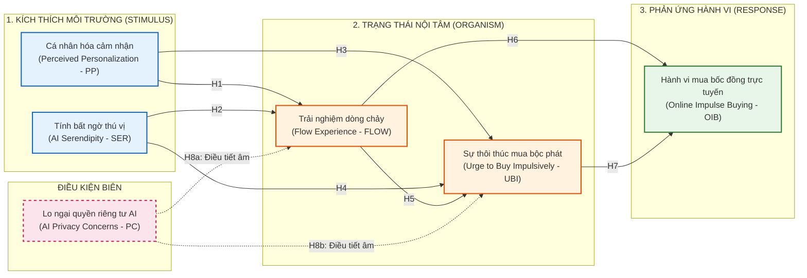

# BẢN THẢO ĐỀ CƯƠNG NGHIÊN CỨU LUẬN ÁN TIẾN SĨ
*(DOCTORAL RESEARCH PROPOSAL DRAFT)*

---

## TÊN ĐỀ TÀI (DISSERTATION TITLE)

- **Tiếng Việt**:
  > **Tác động của hệ thống đề xuất cá nhân hóa dựa trên AI đến hành vi mua bốc đồng của người tiêu dùng trực tuyến: Vai trò trung gian của trải nghiệm dòng chảy, sự thôi thúc mua và sự điều tiết của lo ngại quyền riêng tư.**
- **Tiếng Anh**:
  > **The Impact of AI-Driven Personalized Recommendation Systems on Online Consumer Impulse Buying Behavior: The Mediating Roles of Flow Experience and Urge to Buy Impulsively, and the Moderating Role of AI Privacy Concerns.**

- **Chuyên ngành**: Marketing & Quản trị Kinh doanh (Business Administration)
- **Mã số chuyên ngành**: 9340101 / 9340115

---

## 1. TÍNH CẤP THIẾT VÀ BỐI CẢNH NGHIÊN CỨU (RATIONALE)

Trong kỷ nguyên kinh tế số, các nền tảng thương mại điện tử (Shopee, TikTok Shop, Lazada, Amazon) đang chuyển dịch mạnh mẽ từ các thuật toán gợi ý dựa trên quy tắc đơn giản (rule-based) sang **Hệ thống đề xuất thông minh ứng dụng Trí tuệ Nhân tạo (AI-Driven Personalized Recommendation Systems)**. Nhờ khả năng xử lý dữ liệu lớn theo thời gian thực (hành vi lướt web, lịch sử tìm kiếm, thời gian dừng trên từng sản phẩm), AI có thể dự đoán và gợi ý các sản phẩm có độ cá nhân hóa cực cao, thậm chí trước khi người tiêu dùng kịp định hình nhu cầu rõ ràng.

Hành vi **mua bốc đồng trực tuyến (Online Impulse Buying)** đóng góp một tỷ trọng doanh thu khổng lồ cho các nhà bán lẻ trực tuyến (ước tính chiếm từ 40% đến 80% tổng các giao dịch thương mại điện tử). Mặc dù các doanh nghiệp đầu tư hàng triệu USD vào AI để kích thích doanh số, cơ chế tâm lý lý giải cách thức các gợi ý của AI chuyển hóa thành quyết định mua sắm bộc phát vẫn còn nhiều mắt xích chưa được khai phá thấu đáo:
- Các nghiên cứu trước đây thường tiếp cận theo mô hình duy lý (Rational decision-making), xem sự hài lòng chức năng (Functional satisfaction) là biến trung gian. Tuy nhiên, mua bốc đồng về bản chất là một **hành vi cảm xúc bộc phát phi kế hoạch**. Khách hàng chỉ hài lòng đơn thuần sẽ có xu hướng cân nhắc kỹ lưỡng thay vì mua sắm bốc đồng.
- Sự can thiệp quá sâu của AI làm nảy sinh mối lo ngại về việc xâm phạm đời tư (**AI Privacy Concerns**). Khi người tiêu dùng cảm thấy bị thuật toán theo dõi, họ có thể xuất hiện tâm lý đề phòng và phản kháng (Psychological reactance), làm suy giảm tác động tích cực của hệ thống AI.

---

## 2. KHOẢNG TRỐNG NGHIÊN CỨU (RESEARCH GAPS)

1. **Khoảng trống lý thuyết (Theoretical Gap)**:
   - Các công trình hiện hữu chủ yếu áp dụng Mô hình Chấp nhận Công nghệ (TAM) để giải thích ý định sử dụng AI, nhưng chưa giải thích được cơ chế chuyển hóa từ tác nhân công nghệ sang hành vi cảm xúc bốc phát. Nghiên cứu này kết hợp **Khung lý thuyết S-O-R** và **Thuyết Tính toán Quyền riêng tư (Privacy Calculus Theory)** để xây dựng mô hình giải thích đa chiều.
2. **Khoảng trống thực nghiệm (Empirical Gap)**:
   - Kết quả thực nghiệm về vai trò của cá nhân hóa AI đối với hành vi tiêu dùng còn mâu thuẫn: một số học giả chỉ ra rằng cá nhân hóa gia tăng mức độ gắn kết, trong khi số khác phát hiện hiệu ứng "thung lũng kỳ lạ" (Uncanny valley) hoặc tâm lý bất an khi thuật toán "quá hiểu" người dùng. Sự thiếu đồng thuận này đòi hỏi phải kiểm định vai trò điều tiết của **Lo ngại quyền riêng tư AI (AI Privacy Concerns)**.
3. **Khoảng trống bối cảnh (Contextual Gap)**:
   - Đa số nghiên cứu về hệ thống gợi ý AI được tiến hành tại các thị trường phát triển phương Tây (Mỹ, Châu Âu), nơi người tiêu dùng có mức độ hiểu biết số và văn hóa cá nhân chủ nghĩa. Việc kiểm chứng mô hình tại **thị trường mới nổi như Việt Nam** (đặc trưng bởi văn hóa tập thể, mức độ bảo vệ dữ liệu cá nhân đang hoàn thiện và sự bùng nổ của thế hệ Gen Z mua sắm qua livestream/social commerce) mang lại đóng góp thực tiễn quan trọng.

---

## 3. CÂU HỎI NGHIÊN CỨU VÀ MỤC TIÊU NGHIÊN CỨU

### 3.1. Câu hỏi nghiên cứu (Research Questions - RQs)
- **RQ1**: Các khía cạnh của hệ thống đề xuất cá nhân hóa dựa trên AI (Độ cá nhân hóa cảm nhận và Tính bất ngờ thú vị) tác động như thế nào đến trạng thái nội tâm của người tiêu dùng trực tuyến?
- **RQ2**: Cơ chế trung gian kép của Trải nghiệm dòng chảy (Flow experience) và Sự thôi thúc mua bốc đồng (Urge to buy impulsively) giải thích mối quan hệ giữa hệ thống AI và hành vi mua bốc đồng như thế nào?
- **RQ3**: Mối lo ngại quyền riêng tư AI (AI Privacy Concerns) điều tiết mối quan hệ giữa kích thích từ hệ thống gợi ý AI và trạng thái tâm lý của người tiêu dùng ra sao?
- **RQ4**: Các nhà bán lẻ trực tuyến và doanh nghiệp thương mại điện tử cần thực thi những giải pháp chiến lược nào để vừa kích hoạt hành vi mua sắm, vừa giảm thiểu tâm lý e ngại quyền riêng tư của khách hàng?

### 3.2. Mục tiêu nghiên cứu (Research Objectives - ROs)
- **RO1**: Hệ thống hóa cơ sở lý luận và xác định các nhân tố cấu thành hệ thống đề xuất AI tác động đến tâm lý người tiêu dùng.
- **RO2**: Kiểm định thực nghiệm vai trò trung gian nối tiếp của Trải nghiệm dòng chảy tâm lý và Sự thôi thúc mua bộc phát.
- **RO3**: Đánh giá điều kiện biên (vai trò điều tiết) của Lo ngại quyền riêng tư đối với hiệu quả của hệ thống gợi ý AI.
- **RO4**: Đề xuất các hàm ý quản trị và kiến nghị chính sách nhằm tối ưu hóa trải nghiệm khách hàng và hiệu quả kinh doanh số.

---

## 4. KHUNG LÝ THUYẾT NỀN TẢNG (THEORETICAL FOUNDATIONS)

Luận án dựa trên 2 lý thuyết nền tảng tương hỗ:

1. **Khung lý thuyết Kích thích - Cơ thể - Phản ứng (S-O-R Framework)** *(Mehrabian & Russell, 1974; Jacoby, 2002)*:
   - **Kích thích môi trường (Stimulus - S)**: Bao gồm *Độ cá nhân hóa cảm nhận (Perceived Personalization)* và *Tính bất ngờ thú vị (Serendipity)* của hệ thống đề xuất AI.
   - **Trạng thái nội tâm (Organism - O)**: Trạng thái đắm chìm vào không gian số (*Flow Experience*) và phản ứng cảm xúc thôi thúc bộc phát (*Urge to Buy Impulsively*).
   - **Phản ứng hành vi (Response - R)**: Quyết định thực hiện *Hành vi mua bốc đồng trực tuyến (Online Impulse Buying)*.
2. **Thuyết Tính toán Quyền riêng tư (Privacy Calculus Theory)** *(Culnan & Bies, 2003)*:
   - Người tiêu dùng luôn đặt lên bàn cân giữa **Lợi ích nhận được** (sự tiện lợi, tìm thấy sản phẩm ưa thích nhanh chóng nhờ AI) và **Cái giá phải trả** (dữ liệu cá nhân, hành vi bị theo dõi). Khi nỗi lo ngại quyền riêng tư vượt ngưỡng, nó sẽ tạo ra rào cản tâm lý kìm hãm phản ứng tích cực đối với hệ thống gợi ý.

---

## 5. MÔ HÌNH NGHIÊN CỨU ĐỀ XUẤT (CONCEPTUAL MODEL)

---

## 6. HỆ THỐNG GIẢ THUYẾT NGHIÊN CỨU (HYPOTHESES DEVELOPMENT)

- **$H_1$**: *Mức độ cá nhân hóa cảm nhận của hệ thống gợi ý AI có tác động tích cực đến Trải nghiệm dòng chảy tâm lý của người tiêu dùng.*
- **$H_2$**: *Tính bất ngờ thú vị (Serendipity) của hệ thống gợi ý AI có tác động tích cực đến Trải nghiệm dòng chảy tâm lý.*
- **$H_3$**: *Mức độ cá nhân hóa cảm nhận của hệ thống gợi ý AI có tác động tích cực đến Sự thôi thúc mua sắm bộc phát.*
- **$H_4$**: *Tính bất ngờ thú vị của hệ thống gợi ý AI có tác động tích cực đến Sự thôi thúc mua sắm bộc phát.*
- **$H_5$**: *Trải nghiệm dòng chảy tâm lý có tác động tích cực đến Sự thôi thúc mua sắm bộc phát.*
- **$H_6$**: *Trải nghiệm dòng chảy tâm lý có tác động tích cực đến Hành vi mua bốc đồng trực tuyến.*
- **$H_7$**: *Sự thôi thúc mua sắm bộc phát có tác động tích cực đến Hành vi mua bốc đồng trực tuyến.*
- **$H_{8a}$**: *Mối lo ngại quyền riêng tư AI điều tiết tiêu cực mối quan hệ giữa Cá nhân hóa cảm nhận và Trải nghiệm dòng chảy, sao cho tác động tích cực này sẽ suy giảm khi lo ngại quyền riêng tư ở mức cao.*
- **$H_{8b}$**: *Mối lo ngại quyền riêng tư AI điều tiết tiêu cực mối quan hệ giữa Cá nhân hóa cảm nhận và Sự thôi thúc mua sắm bộc phát.*
- **$H_9$**: *Sự thôi thúc mua sắm bộc phát đóng vai trò trung gian trong mối quan hệ giữa Cá nhân hóa cảm nhận và Hành vi mua bốc đồng trực tuyến.*

---

## 7. BẢNG THAO TÁC HÓA CÁC KHÁI NIỆM (OPERATIONALIZATION OF CONSTRUCTS)
*(Chuẩn mực APA 7th: Bảng 3 đường kẻ ngang, không có đường kẻ dọc)*

| Khái niệm (Construct) | Định nghĩa thao tác hóa (Operational Definition) | Số mục hỏi | Nguồn kế thừa thang đo (Reference Source) |
| :--- | :--- | :---: | :--- |
| **Cá nhân hóa cảm nhận (PP)** | Mức độ người tiêu dùng cảm nhận các gợi ý từ AI phản ánh chính xác sở thích, thói quen và nhu cầu độc bản của họ. | 4 | Shanahan et al. (2019); Xiao & Benbasat (2018) |
| **Tính bất ngờ thú vị (SER)** | Khả năng thuật toán gợi ý những sản phẩm bất ngờ, mới lạ nhưng lại có giá trị tích cực ngoài sự mong đợi của người dùng. | 3 | Foster & Ford (2003); Zhang et al. (2021) |
| **Trải nghiệm dòng chảy (FLOW)** | Trạng thái người tiêu dùng hoàn toàn đắm chìm, tập trung cao độ và quên đi thời gian trong quá trình tương tác với nền tảng. | 4 | Csikszentmihalyi (1990); Novak et al. (2000) |
| **Thôi thúc mua bộc phát (UBI)** | Cảm giác thôi thúc mãnh liệt, đột ngột nảy sinh muốn mua sản phẩm ngay lập tức mà không có kế hoạch trước. | 4 | Beatty & Ferrell (1998); Rook & Fisher (1995) |
| **Mua bốc đồng trực tuyến (OIB)** | Hành động thực tế mua sắm phi kế hoạch diễn ra nhanh chóng sau khi tiếp nhận gợi ý trên nền tảng số. | 3 | Verhagen & van Dolen (2011); Stern (1962) |
| **Lo ngại quyền riêng tư AI (PC)** | Mức độ bất an của khách hàng về việc thuật toán AI thu thập, giám sát và khai thác dữ liệu hành vi cá nhân của họ. | 4 | Dinev & Hart (2006); Xu et al. (2011) |

---

## 8. PHƯƠNG PHÁP NGHIÊN CỨU DỰ KIẾN (METHODOLOGY)

1. **Phương pháp tiếp cận**: Thực chứng (Positivism), phương pháp suy diễn (Deductive approach) kết hợp nghiên cứu hỗn hợp (Mixed-methods):
   - *Giai đoạn 1 (Định tính)*: Thảo luận nhóm chuyên gia ($n=6-8$) để dịch ngược (Back-translation) và thích ứng các thang đo quốc tế sang ngữ cảnh người tiêu dùng Việt Nam. Khảo sát thử nghiệm Pilot study ($n=80$).
   - *Giai đoạn 2 (Định lượng chính thức)*: Khảo sát mẫu lớn người tiêu dùng trực tuyến đã từng mua sắm qua các nền tảng có ứng dụng đề xuất AI (Shopee, TikTok Shop, Lazada).
2. **Cỡ mẫu tối thiểu**:
   - Tính toán bằng **G\*Power 3.1** với effect size $f^2 = 0.15$, $\alpha = 0.05$, Power ($1 - \beta$) = $0.95$, số biến dự báo tối đa = 5 $\rightarrow$ Cỡ mẫu lý thuyết tối thiểu là 138 quan sát.
   - Theo tỷ lệ biến quan sát $10:1$ (Hair et al., 2019) với 22 câu hỏi đo lường $\rightarrow$ Cỡ mẫu cần thiết tối thiểu là $22 \times 10 = 220$ quan sát.
   - Quy mô khảo sát mục tiêu: **$N = 450 - 500$ phiếu khảo sát hợp lệ**.
3. **Kỹ thuật phân tích dữ liệu**:
   - Sử dụng **PLS-SEM (SmartPLS 4)**: Thích hợp cho mô hình dự báo hành vi phức tạp, có cả biến trung gian nối tiếp và biến điều tiết.
   - Kiểm soát sai lệch phương pháp chung (**Common Method Bias - CMB**) qua phép kiểm định đơn nhân tố của Harman (Harman's Single Factor test) và hệ số đa cộng tuyến toàn diện (Full Collinearity VIF).

---

## 9. TÀI LIỆU THAM KHẢO CHỌN LỌC (KEY VERIFIED REFERENCES - APA 7th)

1. Beatty, S. E., & Ferrell, M. E. (1998). Impulse buying: Modeling its precursors. *Journal of Retailing*, 74(2), 169–191. https://doi.org/10.1016/S0022-4359(98)90009-4
2. Culnan, M. J., & Bies, R. J. (2003). Consumer privacy: Balancing economic and justice considerations. *Journal of Social Issues*, 59(2), 323–342. https://doi.org/10.1111/1540-4560.00067
3. Dinev, T., & Hart, P. (2006). An extended privacy calculus model for e-commerce transactions. *Information Systems Research*, 17(1), 61–80. https://doi.org/10.1287/isre.1060.0080
4. Hair, J. F., Risher, J. J., Sarstedt, M., & Ringle, C. M. (2019). When to use and how to report the results of PLS-SEM. *European Business Review*, 31(1), 2–24. https://doi.org/10.1108/EBR-11-2018-0203
5. Mehrabian, A., & Russell, J. A. (1974). *An approach to environmental psychology*. MIT Press.
6. Rook, D. W., & Fisher, R. J. (1995). Normative influences on impulsive buying behavior. *Journal of Consumer Research*, 22(3), 305–313. https://doi.org/10.1086/209452
7. Verhagen, T., & van Dolen, W. (2011). The influence of online store beliefs on consumer online impulse buying: A model and empirical application. *Information & Management*, 48(8), 320–327. https://doi.org/10.1016/j.im.2011.08.001
8. Xiao, B., & Benbasat, I. (2018). An empirical examination of the influence of biased product recommendation agents on credibility and user behavior. *Decision Support Systems*, 111, 22–32. https://doi.org/10.1016/j.dss.2018.04.004
