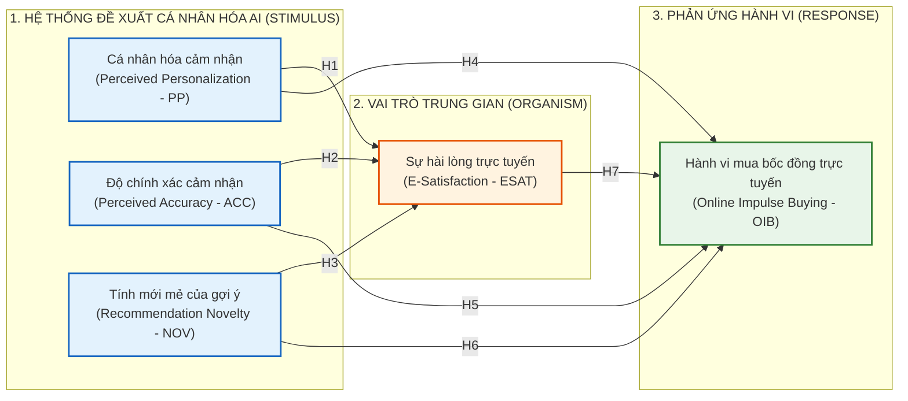

# ĐỀ CƯƠNG NGHIÊN CỨU LUẬN ÁN TIẾN SĨ
*(DOCTORAL DISSERTATION RESEARCH PROPOSAL)*

---

## TÊN ĐỀ TÀI ĐÃ ĐĂNG KÝ CHÍNH THỨC
*(OFFICIALLY REGISTERED TITLE)*

- **Tiếng Việt**: 
  > **Tác động của hệ thống đề xuất cá nhân hóa dựa trên AI đến hành vi mua bốc đồng của người tiêu dùng trực tuyến: Vai trò trung gian của sự hài lòng trực tuyến**
- **Tiếng Anh**: 
  > **The Impact of AI-Driven Personalized Recommendation Systems on Online Consumer Impulse Buying Behavior: The Mediating Role of E-Satisfaction**

- **Chuyên ngành**: Marketing & Quản trị Kinh doanh (Business Administration)
- **Mã số chuyên ngành**: 9340101 / 9340115

---

## 1. TÍNH CẤP THIẾT CỦA ĐỀ TÀI (RATIONALE)

Trong bối cảnh bùng nổ thương mại điện tử và trí tuệ nhân tạo (AI), các nền tảng bán lẻ trực tuyến lớn tại Việt Nam (Shopee, TikTok Shop, Lazada) đang cạnh tranh khốc liệt bằng việc ứng dụng **Hệ thống đề xuất cá nhân hóa dựa trên AI (AI-Driven Personalized Recommendation Systems)**. Thay vì hiển thị danh mục sản phẩm cố định, thuật toán AI liên tục học sâu (deep learning) từ dữ liệu hành vi thời gian thực để gợi ý sản phẩm phù hợp tối đa với sở thích và nhu cầu tức thời của từng khách hàng.

Hành vi **mua bốc đồng trực tuyến (Online Impulse Buying Behavior)** là một trong những động lực thúc đẩy doanh số lớn nhất trong bán lẻ kỹ thuật số. Tuy nhiên, mối liên kết cơ chế giữa tính thông minh của hệ thống AI và hành vi mua bốc đồng thông qua **Sự hài lòng trực tuyến (E-Satisfaction)** vẫn tồn tại những vấn đề học thuật quan trọng:
- Đa phần các nghiên cứu truyền thống xem sự hài lòng là kết quả của việc đánh giá duy lý sau mua sắm (Post-purchase evaluation). Trong môi trường thương mại điện tử tích hợp AI, sự hài lòng nảy sinh **ngay trong quá trình tương tác (In-process E-Satisfaction)**: Khi hệ thống AI gợi ý đúng sản phẩm người dùng đang quan tâm, họ trải nghiệm cảm giác thỏa mãn, thích thú và giảm bớt nỗ lực tìm kiếm, từ đó tạo tiền đề kích hoạt quyết định mua sắm bộc phát.
- Để luận án đạt độ sâu tiến sĩ với tên đề tài đã đăng ký, hệ thống đề xuất AI cần được phân rã thành các **chiều kích cốt lõi** phản ánh tính năng công nghệ (Độ chính xác cảm nhận - Perceived Accuracy, Tính cá nhân hóa cảm nhận - Perceived Personalization, và Tính mới/bất ngờ của gợi ý - Recommendation Novelty), đồng thời sự hài lòng trực tuyến được tiếp cận toàn diện cả về **nhận thức (Cognitive)** lẫn **cảm xúc (Affective)**.

---

## 2. KHOẢNG TRỐNG NGHIÊN CỨU (RESEARCH GAPS)

1. **Khoảng trống lý thuyết (Theoretical Gap)**:
   - Các nghiên cứu trước đây về hệ thống khuyến nghị (Recommendation Agents) chủ yếu sử dụng Mô hình Chấp nhận Công nghệ (TAM) để dự báo ý định mua có kế hoạch (Planned purchase). Nghiên cứu này kết hợp **Lý thuyết Kích thích - Cơ thể - Phản ứng (S-O-R Framework)** và **Lý thuyết Kỳ vọng - Xác nhận (Expectation-Confirmation Theory - ECT)** để giải thích cách thức sự hài lòng trực tuyến đóng vai trò "cầu nối" chuyển hóa kích thích thuật toán thành hành vi phi kế hoạch (Impulse buying).
2. **Khoảng trống thực nghiệm (Empirical Gap)**:
   - Kết quả thực nghiệm về tác động của sự hài lòng trực tuyến đến hành vi mua bốc đồng còn nhiều tranh luận: Một số nghiên cứu cho rằng sự hài lòng thúc đẩy tâm lý mua sắm bộc phát do tâm trạng tích cực (Positive affect), nhưng số khác lại cho rằng người tiêu dùng hài lòng sẽ có xu hướng suy nghĩ thận trọng hơn. Luận án này làm sáng tỏ cơ chế tác động trực tiếp và gián tiếp trong bối cảnh thuật toán AI định hướng.
3. **Khoảng trống bối cảnh (Contextual Gap)**:
   - Các công trình quốc tế chủ yếu thực hiện tại thị trường phát triển. Việc kiểm định mô hình tại thị trường thương mại điện tử mới nổi và tăng trưởng hàng đầu khu vực như Việt Nam sẽ mang lại những đóng góp thực chứng giá trị cho cả giới học thuật và doanh nghiệp bán lẻ số.

---

## 3. MỤC TIÊU VÀ CÂU HỎI NGHIÊN CỨU

### 3.1. Câu hỏi nghiên cứu (Research Questions - RQs)
- **RQ1**: Các khía cạnh đặc tính của hệ thống đề xuất cá nhân hóa dựa trên AI (Cá nhân hóa cảm nhận, Độ chính xác cảm nhận, Tính mới mẻ của gợi ý) tác động như thế nào đến Sự hài lòng trực tuyến của khách hàng?
- **RQ2**: Sự hài lòng trực tuyến tác động như thế nào đến Hành vi mua bốc đồng của người tiêu dùng trực tuyến?
- **RQ3**: Sự hài lòng trực tuyến đóng vai trò trung gian như thế nào trong mối quan hệ giữa hệ thống đề xuất cá nhân hóa dựa trên AI và Hành vi mua bốc đồng?
- **RQ4**: Doanh nghiệp thương mại điện tử cần thực thi các hàm ý quản trị nào về thuật toán AI và thiết kế giao diện để gia tăng sự hài lòng và kích hoạt hành vi mua sắm hiệu quả?

### 3.2. Mục tiêu nghiên cứu (Research Objectives - ROs)
- **RO1**: Xác định và đo lường các chiều kích cấu thành Hệ thống đề xuất cá nhân hóa dựa trên AI tác động đến Sự hài lòng trực tuyến.
- **RO2**: Kiểm định thực nghiệm tác động của Sự hài lòng trực tuyến đến Hành vi mua bốc đồng của người tiêu dùng.
- **RO3**: Đánh giá và kiểm định vai trò trung gian (Mediating effect) của Sự hài lòng trực tuyến.
- **RO4**: Đề xuất hệ thống giải pháp và hàm ý quản trị cho các nhà bán lẻ trực tuyến tại Việt Nam.

---

## 4. CƠ SỞ LÝ THUYẾT NỀN TẢNG (THEORETICAL FOUNDATIONS)

Luận án được xây dựng dựa trên 2 khung lý thuyết nền:

1. **Khung lý thuyết S-O-R (Stimulus - Organism - Response)** *(Mehrabian & Russell, 1974; Jacoby, 2002)*:
   - **Tác nhân kích thích (Stimulus - S)**: Hệ thống đề xuất cá nhân hóa dựa trên AI với 3 đặc tính: *Cá nhân hóa cảm nhận (Perceived Personalization)*, *Độ chính xác cảm nhận (Perceived Accuracy)*, và *Tính mới mẻ của gợi ý (Recommendation Novelty)*.
   - **Trạng thái nội tâm (Organism - O)**: *Sự hài lòng trực tuyến (E-Satisfaction)*, phản ánh trạng thái đánh giá tích cực của người tiêu dùng về trải nghiệm tương tác với hệ thống.
   - **Phản ứng hành vi (Response - R)**: *Hành vi mua bốc đồng trực tuyến (Online Consumer Impulse Buying Behavior)*.
2. **Lý thuyết Kỳ vọng - Xác nhận (Expectation-Confirmation Theory - ECT)** *(Oliver, 1980; Bhattacherjee, 2001)*:
   - Khi gợi ý của AI đáp ứng hoặc vượt quá kỳ vọng của người tiêu dùng về sự chính xác và tiện lợi, sự xác nhận kỳ vọng sẽ hình thành nên sự hài lòng trực tuyến cao, tạo ra trạng thái tâm lý thoải mái, sẵn sàng đón nhận và ra quyết định mua hàng nhanh chóng mà không cần đắn đo dài dòng.

---

## 5. MÔ HÌNH NGHIÊN CỨU ĐỀ XUẤT (CONCEPTUAL MODEL)

---

## 6. HỆ THỐNG GIẢ THUYẾT NGHIÊN CỨU (HYPOTHESES DEVELOPMENT)

### 6.1. Tác động của các khía cạnh Hệ thống đề xuất AI đến Sự hài lòng trực tuyến
- **$H_1$**: *Cá nhân hóa cảm nhận của hệ thống đề xuất AI có tác động tích cực đến Sự hài lòng trực tuyến của người tiêu dùng.*
  - *Cơ sở*: Khi khách hàng cảm nhận sản phẩm gợi ý được thiết kế "đo ni đóng giày" cho riêng họ, nỗ lực tìm kiếm giảm đi và cảm xúc thỏa mãn gia tăng (Shanahan et al., 2019; Xiao & Benbasat, 2018).
- **$H_2$**: *Độ chính xác cảm nhận của hệ thống đề xuất AI có tác động tích cực đến Sự hài lòng trực tuyến.*
  - *Cơ sở*: Thuật toán đề xuất chính xác các mặt hàng đúng thời điểm và sở thích đáp ứng kỳ vọng của người mua, củng cố mức độ thỏa mãn dịch vụ (Al-Natour et al., 2011).
- **$H_3$**: *Tính mới mẻ của gợi ý AI có tác động tích cực đến Sự hài lòng trực tuyến.*
  - *Cơ sở*: Sự gợi ý những sản phẩm mới lạ, độc đáo nhưng phù hợp đem lại cảm giác ngạc nhiên thú vị (Serendipity/Novelty), kích hoạt sự hài lòng cảm xúc (Foster & Ford, 2003).

### 6.2. Tác động trực tiếp đến Hành vi mua bốc đồng trực tuyến
- **$H_4$**: *Cá nhân hóa cảm nhận có tác động tích cực trực tiếp đến Hành vi mua bốc đồng trực tuyến.*
- **$H_5$**: *Độ chính xác cảm nhận có tác động tích cực trực tiếp đến Hành vi mua bốc đồng trực tuyến.*
- **$H_6$**: *Tính mới mẻ của gợi ý có tác động tích cực trực tiếp đến Hành vi mua bốc đồng trực tuyến.*

### 6.3. Tác động của Sự hài lòng trực tuyến và Vai trò trung gian
- **$H_7$**: *Sự hài lòng trực tuyến có tác động tích cực đến Hành vi mua bốc đồng trực tuyến.*
  - *Cơ sở*: Khách hàng đang trong trạng thái hài lòng và có tâm trạng tích cực thường hạ thấp nhận thức về rủi ro, nới lỏng kiểm soát tài chính và dễ đưa ra quyết định mua sắm bộc phát (Beatty & Ferrell, 1998; Verhagen & van Dolen, 2011).
- **$H_{8a}$**: *Sự hài lòng trực tuyến đóng vai trò trung gian trong mối quan hệ giữa Cá nhân hóa cảm nhận và Hành vi mua bốc đồng trực tuyến.*
- **$H_{8b}$**: *Sự hài lòng trực tuyến đóng vai trò trung gian trong mối quan hệ giữa Độ chính xác cảm nhận và Hành vi mua bốc đồng trực tuyến.*
- **$H_{8c}$**: *Sự hài lòng trực tuyến đóng vai trò trung gian trong mối quan hệ giữa Tính mới mẻ của gợi ý và Hành vi mua bốc đồng trực tuyến.*

---

## 7. BẢNG THAO TÁC HÓA CÁC BIẾN SỐ VÀ THANG ĐO KẾ THỪA
*(Chuẩn mực APA 7th: Bảng 3 đường kẻ ngang)*

| Khái niệm (Construct) | Định nghĩa thao tác hóa (Operational Definition) | Số mục hỏi | Nguồn kế thừa thang đo (Reference Source) |
| :--- | :--- | :---: | :--- |
| **Cá nhân hóa cảm nhận (PP)** | Mức độ khách hàng cảm thấy gợi ý phản ánh đúng sở thích, lịch sử duyệt và nhu cầu riêng của bản thân. | 4 | Shanahan et al. (2019); Xiao & Benbasat (2018) |
| **Độ chính xác cảm nhận (ACC)** | Mức độ sản phẩm được gợi ý đúng với mong muốn thực tế và có tính ứng dụng cao. | 3 | Al-Natour et al. (2011); Komiak & Benbasat (2006) |
| **Tính mới mẻ của gợi ý (NOV)** | Mức độ các gợi ý mang tính sáng tạo, bất ngờ và kích thích khám phá những mặt hàng mới. | 3 | Zhang et al. (2021); Foster & Ford (2003) |
| **Sự hài lòng trực tuyến (ESAT)** | Đánh giá tổng thể tích cực và sự thỏa mãn của khách hàng đối với trải nghiệm được gợi ý bởi hệ thống AI. | 4 | Anderson & Srinivasan (2003); Oliver (1980, 1993) |
| **Mua bốc đồng trực tuyến (OIB)** | Hành động mua sắm phi kế hoạch diễn ra nhanh chóng dưới tác động trực tiếp của các đề xuất AI trên nền tảng. | 4 | Beatty & Ferrell (1998); Rook & Fisher (1995); Verhagen & van Dolen (2011) |

---

## 8. PHƯƠNG PHÁP NGHIÊN CỨU DỰ KIẾN (METHODOLOGY)

1. **Thiết kế nghiên cứu**:
   - Nghiên cứu định tính sơ bộ: Phỏng vấn sâu 6 chuyên gia (giảng viên marketing và giám đốc e-commerce) để hoàn thiện bảng dịch thang đo.
   - Nghiên cứu thử nghiệm (Pilot study): $N = 60 - 80$ người tiêu dùng trực tuyến nhằm kiểm tra độ tin cậy sơ bộ Cronbach's Alpha ($\ge 0.70$).
   - Nghiên cứu định lượng chính thức: Khảo sát người tiêu dùng trực tuyến thường xuyên mua sắm trên các sàn thương mại điện tử có thuật toán đề xuất (Shopee, TikTok Shop, Lazada).
2. **Cỡ mẫu**:
   - Xác định bằng **G\*Power 3.1** ($f^2 = 0.15, \alpha = 0.05$, Power = $0.95$, số biến dự báo = 4) $\rightarrow$ Cỡ mẫu tối thiểu 129 quan sát.
   - Tỷ lệ quan sát theo Hair et al. (2019): Thang đo gồm 18 biến quan sát $\rightarrow$ Cỡ mẫu khuyến nghị tối thiểu $18 \times 10 = 180$ mẫu.
   - **Mục tiêu thu thập thực tế**: **$N = 350 - 450$ phiếu khảo sát hợp lệ**.
3. **Phân tích dữ liệu**:
   - Mô hình phương trình cấu trúc bình phương bé nhất từng phần (**PLS-SEM**) trên phần mềm SmartPLS 4.
   - Kiểm tra Common Method Bias (CMB) bằng kiểm định Harman's Single Factor test.
   - Đánh giá mô hình đo lường (Outer Loadings $\ge 0.708$, Cronbach's $\alpha \ge 0.70$, $\text{CR} \ge 0.70$, $\text{AVE} \ge 0.50$, $\text{HTMT} < 0.85$).
   - Đánh giá mô hình cấu trúc (Bootstrapping 5,000 mẫu để kiểm định các giả thuyết trực tiếp và gián tiếp/trung gian).

---

## 9. DANH MỤC TÀI LIỆU THAM KHẢO CHỌN LỌC (VERIFIED REFERENCES - APA 7th)

1. Al-Natour, S., Benbasat, I., & Cenfetelli, R. (2011). The adoption of online shopping assistants: Perceived similarity as an antecedent to evaluative beliefs. *Journal of the Association for Information Systems*, 12(5), 347–374. https://doi.org/10.17705/1jais.00267
2. Anderson, R. E., & Srinivasan, S. S. (2003). E-satisfaction and e-loyalty: A contingency framework. *Psychology & Marketing*, 20(2), 123–138. https://doi.org/10.1002/mar.10063
3. Beatty, S. E., & Ferrell, M. E. (1998). Impulse buying: Modeling its precursors. *Journal of Retailing*, 74(2), 169–191. https://doi.org/10.1016/S0022-4359(98)90009-4
4. Hair, J. F., Risher, J. J., Sarstedt, M., & Ringle, C. M. (2019). When to use and how to report the results of PLS-SEM. *European Business Review*, 31(1), 2–24. https://doi.org/10.1108/EBR-11-2018-0203
5. Mehrabian, A., & Russell, J. A. (1974). *An approach to environmental psychology*. MIT Press.
6. Oliver, R. L. (1980). A cognitive model of the antecedents and consequences of satisfaction decisions. *Journal of Marketing Research*, 17(4), 460–469. https://doi.org/10.1177/002224378001700405
7. Rook, D. W., & Fisher, R. J. (1995). Normative influences on impulsive buying behavior. *Journal of Consumer Research*, 22(3), 305–313. https://doi.org/10.1086/209452
8. Shanahan, T., Tran, T. P., & Taylor, E. C. (2019). Getting personal: How social media recommendation agents and personal relevance influence consumer attitudes. *Journal of Business Research*, 103, 408–416. https://doi.org/10.1016/j.jbusres.2019.02.049
9. Verhagen, T., & van Dolen, W. (2011). The influence of online store beliefs on consumer online impulse buying: A model and empirical application. *Information & Management*, 48(8), 320–327. https://doi.org/10.1016/j.im.2011.08.001
10. Xiao, B., & Benbasat, I. (2018). An empirical examination of the influence of biased product recommendation agents on credibility and user behavior. *Decision Support Systems*, 111, 22–32. https://doi.org/10.1016/j.dss.2018.04.004
