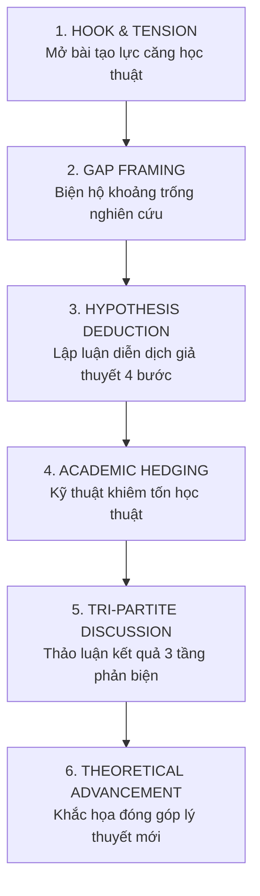
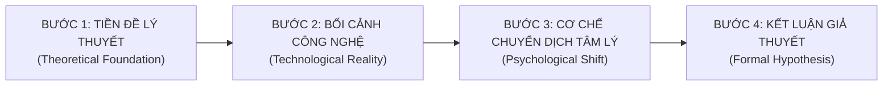

# CẨM NANG KHAI PHÁ VĂN PHONG & NGHỆ THUẬT LẬP LUẬN HỌC THUẬT QUỐC TẾ (ACADEMIC WRITING & RHETORICAL DISCOURSE GUIDE)
*(Thư viện Tri thức Luận án Tiến sĩ - NCS Lê Phúc Hải | Phân Tích Cú Pháp Từ Các Tạp Chí FT50 & Scopus Q1)*

---

## 1. MỤC ĐÍCH CỦA CẨM NANG
Không chỉ dừng lại ở số liệu và kết quả thống kê, việc nghiên cứu các bài báo đỉnh cao (*Journal of Marketing, JAMS, Journal of Consumer Research, Information & Management, Journal of Retailing, JRCS*) cung cấp cho Nghiên cứu sinh **khuôn mẫu thành văn (Scholarly Discourse Patterns)**, **nghệ thuật dẫn dắt lập luận (Rhetorical Moves)** và **cấu trúc câu chuẩn mực** để viết Chương 1, Chương 2, Chương 4, Chương 5 và các bài báo Scopus Q1.

---

## 2. NGHỆ THUẬT 1: CÁCH MỞ BÀI TẠO LỰC CĂNG HỌC THUẬT (HOOK & TENSION CREATION)

### Phân tích cú pháp mở bài từ Miao et al. (2021, *Journal of Marketing*) & Huang & Rust (2022, *Journal of Retailing*):
Các tác giả hàng đầu **không bao giờ mở đầu bằng những câu sáo rỗng vô thưởng vô phạt** (như: *"Trong thời đại công nghệ số 4.0 phát triển mạnh mẽ..."*). Thay vào đó, họ luôn áp dụng **Công thức Tam đoạn tạo lực căng**:
1. **Bước 1 (Thực tiễn bùng nổ)**: Nêu bật một xu hướng thực tế đang làm thay đổi toàn bộ thị trường.
2. **Bước 2 (Nghịch lý nhận thức / Lý thuyết bế tắc)**: Chỉ ra rằng các lý thuyết hiện có chưa theo kịp hoặc đưa ra các giải thích mâu thuẫn.
3. **Bước 3 (Sứ mệnh cứu rỗi của bài báo)**: Giới thiệu nghiên cứu như một nỗ lực tất yếu nhằm giải tỏa nghịch lý đó.

#### Mẫu câu thực chiến áp dụng cho Luận án:
* **Tiếng Anh**:
  > *"While artificial intelligence-driven recommendation systems have fundamentally reshaped modern electronic retailing by personalizing the consumer journey, this algorithmic efficiency introduces an unresolved psychological tension: does tailored curation empower rational decision-making, or does it trigger involuntary, hedonic impulsive purchasing?"*
* **Tiếng Việt**:
  > *"Trong khi các hệ thống đề xuất dựa trên trí tuệ nhân tạo đã tái định hình căn bản hoạt động bán lẻ trực tuyến thông qua việc cá nhân hóa hành trình khách hàng, sự can thiệp của thuật toán lại làm nảy sinh một lực căng tâm lý chưa có lời giải: liệu việc tinh chỉnh nội dung đề xuất giúp giải tỏa nỗ lực nhận thức của người tiêu dùng, hay ngược lại, lại kích hoạt những xung năng chi tiêu bốc đồng ngoài kế hoạch?"*

---

## 3. NGHỆ THUẬT 2: CÁCH CHỈ RA VÀ BIỆN HỘ KHOẢNG TRỐNG NGHIÊN CỨU (GAP FRAMING)

### Phân tích cú pháp từ Shanahan et al. (2019, *JRCS*) và Xiao & Benbasat (2018, *DSS*):
Một khoảng trống nghiên cứu (Research Gap) xuất sắc phải chứng minh được **3 dạng khoảng trống** (Không bao giờ nói chung chung: *"chưa có ai làm nên tôi làm"*):

### Dạng 1: Khoảng trống về cơ chế trung gian tâm lý (Mechanistic Black Box Gap)
* **Cú pháp tiếng Anh**:
  > *"Although prior scholarship has established a positive link between [AI recommendation quality] and [purchasing outcomes], the underlying affective-cognitive mechanisms through which algorithmic stimuli translate into state-specific impulsive urges remain largely an unexamined 'black box'."*
* **Cú pháp tiếng Việt**:
  > *"Mặc dù các công trình trước đây đã ghi nhận mối quan hệ tích cực giữa [chất lượng gợi ý AI] và [kết quả mua hàng], cơ chế tâm lý nhận thức – cảm xúc dẫn truyền kích thích thuật toán sang trạng thái thôi thúc bốc đồng tức thời phần lớn vẫn là một 'khoảng tối' chưa được khai phá thấu đáo."*

### Dạng 2: Khoảng trống về tính đồng bộ thời gian (Temporal Inconsistency Gap)
* **Cú pháp tiếng Anh**:
  > *"Extant literature conventionally conceptualizes satisfaction as a retrospective, cumulative post-purchase evaluation. However, in algorithmic shopping environments, this conceptualization fails to capture in-process affective gratification experienced during live interaction, which serves as the actual catalyst for spontaneous purchases."*
* **Cú pháp tiếng Việt**:
  > *"Y văn hiện hữu thường quy ước sự hài lòng là một đánh giá tích lũy mang tính hồi tưởng sau mua. Tuy nhiên, trong không gian mua sắm dựa trên thuật toán, quan niệm này không phản ánh được trạng thái thỏa mãn nảy sinh tức thời ngay trong phiên tương tác, vốn mới chính là ngòi nổ kích hoạt các quyết định mua sắm tự phát."*

### Dạng 3: Khoảng trống về điều kiện biên kìm hãm (Boundary Condition Void)
* **Cú pháp tiếng Anh**:
  > *"By predominantly viewing consumers as passive recipients of algorithmic influence, past studies have neglected critical internal psychological inhibitors. Whether consumer self-control can buffer against algorithmic persuasion represents an urgent empirical question."*
* **Cú pháp tiếng Việt**:
  > *"Do chủ yếu xem người tiêu dùng là đối tượng tiếp nhận thụ động trước sự điều phối của thuật toán, các nghiên cứu trước đây đã bỏ qua những rào cản kìm hãm tâm lý nội tại. Liệu năng lực tự kiểm soát của cá nhân có thể đóng vai trò như một tấm khiên hóa giải tác động của thuật toán hay không vẫn là một câu hỏi thực nghiệm cấp thiết."*

---

## 4. NGHỆ THUẬT 3: CÔNG THỨC DIỄN DỊCH GIẢ THUYẾT 4 BƯỚC (HYPOTHESIS DEDUCTION)

Mỗi đoạn văn lập luận bảo vệ giả thuyết trong Chương 2 phải tuân theo cấu trúc **Diễn dịch 4 bước** chặt chẽ (Tránh việc chỉ nêu 2 dòng rồi đưa ra giả thuyết):

#### Ví dụ mẫu diễn dịch Giả thuyết H1 (PP $\rightarrow$ ESAT):
1. **Tiền đề lý thuyết**: *"Theo Lý thuyết Phù hợp Nhận thức (Cognitive Fit Theory - Vessey, 1991), hiệu quả và cảm xúc tích cực của cá nhân đạt mức tối ưu khi định dạng thông tin do hệ thống cung cấp trùng khớp hoàn hảo với cấu trúc nhiệm vụ của họ."*
2. **Bối cảnh công nghệ**: *"Trong môi trường thương mại điện tử, các thuật toán học máy liên tục thu thập và phân tích dữ liệu hành vi quá khứ nhằm tùy biến danh mục sản phẩm theo đúng sở thích của từng người dùng riêng biệt (Shanahan et al., 2019)."*
3. **Cơ chế chuyển dịch tâm lý**: *"Khi người tiêu dùng cảm nhận được sự cá nhân hóa cao, nỗ lực tìm kiếm thông tin và gánh nặng xử lý nhận thức được giải phóng đáng kể. Sự trơn tru trong tương tác này đem lại trạng thái thỏa mãn và hưng phấn ngay trong phiên duyệt web (Xiao & Benbasat, 2018)."*
4. **Kết luận giả thuyết**:
   > *"Dựa trên các cơ sở lý luận và lập luận nêu trên, giả thuyết sau được đề xuất:*  
   > ***$H_1$: Cá nhân hóa cảm nhận (PP) có tác động tích cực đến Sự hài lòng trong quá trình (ESAT).***"*

---

## 5. NGHỆ THUẬT 4: KỸ THUẬT KHIÊM TỐN HỌC THUẬT (ACADEMIC HEDGING)

### Nguyên tắc sống còn: Tuyệt đối không dùng từ ngữ khẳng định cực đoan
Các giáo sư phản biện quốc tế sẽ ngay lập tức bác bỏ bản thảo nếu tác giả dùng các từ khẳng định tuyệt đối (*"chứng minh hoàn toàn 100%"*, *"chắc chắn giải quyết triệt để"*, *"nghiên cứu đầu tiên và duy nhất"*). Thay vào đó, hãy sử dụng **Kỹ thuật Hedging** để giữ sự thận trọng khách quan:

| Lối hành văn cực đoan (CẤM DÙNG) | Ngôn từ Học thuật Thận trọng (HEDGING CHUẨN) |
| :--- | :--- |
| *"Kết quả này chứng minh 100% rằng..."* | $\rightarrow$ *"Kết quả thực nghiệm cung cấp bằng chứng ủng hộ mạnh mẽ cho nhận định rằng..."* |
| *"Nghiên cứu này là nghiên cứu đầu tiên và duy nhất..."* | $\rightarrow$ *"Theo hiểu biết tốt nhất của tác giả, đây là một trong những nỗ lực bước đầu nhằm..."* |
| *"Thuật toán AI chắc chắn luôn luôn khiến người mua..."* | $\rightarrow$ *"Thuật toán AI có xu hướng gia tăng khả năng người mua..."* |
| *"Nghiên cứu giải quyết hoàn toàn vấn đề..."* | $\rightarrow$ *"Nghiên cứu đóng góp một góc nhìn bổ trợ có giá trị nhằm làm sáng tỏ..."* |

---

## 6. NGHỆ THUẬT 5: CÔNG THỨC THẢO LUẬN KẾT QUẢ 3 TẦNG (DISCUSSION SECTION)

Khi viết phần Thảo luận (Chương 4), bạn áp dụng **Công thức 3 tầng** để thể hiện tư duy học thuật vượt trội:

1. **Tầng 1 (Xác nhận số liệu)**: Nêu rõ giả thuyết được ủng hộ hay bác bỏ kèm chỉ số thống kê ($\beta, t\text{-value}, p\text{-value}$).
2. **Tầng 2 (Đối thoại với Y văn)**: So sánh phát hiện của mình với các công trình trước. Kết quả này ủng hộ ai? Phản bác ai?
   - *Ví dụ*: *"Phát hiện này đồng thuận với kết luận của Gallin & Portes (2024) và Ampadu et al. (2022), củng cố luận điểm cho rằng gợi ý cá nhân hóa là chất xúc tác cảm xúc mạnh mẽ."*
3. **Tầng 3 (Biện giải Nguyên nhân)**: Giải thích TẠI SAO mối quan hệ này lại xảy ra trong bối cảnh cụ thể (dựa vào lý thuyết nền và đặc thù thị trường Việt Nam).

---

## 7. NGHỆ THUẬT 6: CÁCH TRÌNH BÀY ĐÓNG GÓP LÝ THUYẾT (THEORETICAL CONTRIBUTIONS)

Trong Chương 5 và phần Discussion của bài báo Scopus Q1, hãy phân tách đóng góp lý thuyết thành **3 đóng góp rành mạch**:

1. **Đóng góp 1 (Mở rộng Lý thuyết - Theoretical Extension)**:  
   *"Thứ nhất, nghiên cứu này mở rộng biên độ ứng dụng của Khung lý thuyết S-O-R (Mehrabian & Russell, 1974) sang không gian tương tác thuật toán AI thế hệ mới..."*
2. **Đóng góp 2 (Làm sáng tỏ Cơ chế - Mechanistic Clarification)**:  
   *"Thứ hai, bằng việc thiết lập mô hình trung gian chuỗi ($\text{ESAT} \rightarrow \text{UBI}$), nghiên cứu giải mã chiếc 'hộp đen' tâm lý kết nối kích thích công nghệ với hành vi bốc đồng..."*
3. **Đóng góp 3 (Xác lập Điều kiện biên - Boundary Condition Delineation)**:  
   *"Thứ ba, nghiên cứu này cung cấp cái nhìn biện chứng và cân bằng hơn khi đưa biến số Tự kiểm soát (Self-Control) vào làm rào cản kìm hãm, chứng minh rằng con người không hoàn toàn là đối tượng bị động trước thuật toán."*
