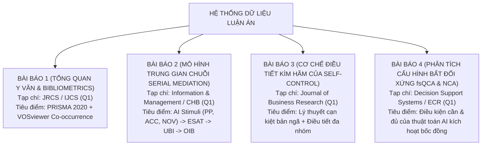

# VƯỜN ƯƠM Ý TƯỞNG CÔNG BỐ BÀI BÁO SCOPUS Q1 (RESEARCH IDEA INCUBATOR)
*(Chiến lược Khai phóng Dữ liệu Luận án Thành 4 Công trình Quốc tế Đầu ngành)*

---

## 1. TỔNG QUAN CHIẾN LƯỢC CÔNG BỐ SCOPUS Q1

Từ hệ sinh thái dữ liệu của luận án (tập 1.441 bài báo Dimensions làm sạch, mạng lưới 866 bài VOSviewer, và bộ thang đo thực nghiệm 8 biến số), chúng ta có thể triển khai chiến lược công bố **4 bài báo Scopus Q1 độc lập** mà không hề trùng lặp đóng góp học thuật:

---

## 2. BẢN THIẾT KẾ CHI TIẾT 4 BÀI BÁO KHOA HỌC

### BÀI BÁO 1: Tổng quan Y văn Hệ thống & Bản đồ Thư mục Trắc lượng (SLR & Bibliometrics)
* **Tiêu đề dự kiến**:  
  *Mapping the Landscape of Artificial Intelligence Recommendations and Consumer Impulse Buying: A PRISMA 2020 Systematic Review and Co-Word Bibliometric Analysis*
* **Tạp chí mục tiêu**: *Journal of Retailing and Consumer Services* (Scopus Q1, IF 11.0) hoặc *International Journal of Consumer Studies* (Scopus Q1).
* **Nguồn dữ liệu sẵn có**:
  - Tập dữ liệu 1.441 bài báo Scopus Q1/Q2 (`data/processed/dimensions_clean_included.csv`).
  - Ma trận đồng xuất hiện 28 từ khóa cốt lõi và 250 liên kết mạng lưới (`luan_an_real_network.json`).
  - Lưu đồ quy chuẩn PRISMA 2020 (`web/prisma_flowchart.html`).
* **Đóng góp học thuật độc đáo**:
  - Bài báo đầu tiên phân loại 4 cụm nghiên cứu (Clusters) giao thoa giữa thuật toán gợi ý AI, trạng thái nhận thức - cảm xúc, và hành vi mua sắm bốc đồng giai đoạn 2018–2025.
  - Cung cấp khung chương trình nghiên cứu tương lai (Future Research Agenda) theo phương pháp TCCM (Theory, Context, Characteristics, Methodology).

---

### BÀI BÁO 2: Mô hình Trung gian Chuỗi của Thuật toán AI trong Mua sắm Bốc đồng
* **Tiêu đề dự kiến**:  
  *Unraveling the Algorithmic Urge: A Serial Mediation Model of AI Recommendation Features, In-Process E-Satisfaction, and Online Impulse Buying*
* **Tạp chí mục tiêu**: *Information & Management* (Scopus Q1, IF 9.9) hoặc *Computers in Human Behavior* (Scopus Q1, IF 9.0).
* **Câu hỏi nghiên cứu (Research Questions)**:
  - *RQ1*: Tính mới mẻ (NOV) hay Độ chính xác (ACC) của gợi ý AI đóng vai trò chi phối mạnh hơn đối với sự hài lòng trong quá trình (ESAT)?
  - *RQ2*: Liệu sự hài lòng trong phiên duyệt web có đóng vai trò cầu nối dẫn truyền kích thích thuật toán sang xung năng thôi thúc mua sắm tức thời (UBI)?
* **Phương pháp phân tích**: PLS-SEM (SmartPLS 4) với kỹ thuật Bootstrapping 5.000 mẫu để kiểm định ý nghĩa thống kê của hiệu ứng trung gian chuỗi gián tiếp chuyên biệt (Specific Indirect Effects).

---

### BÀI BÁO 3: Cơ chế Điều tiết Kìm hãm của Khả năng Tự kiểm soát (Boundary Condition)
* **Tiêu đề dự kiến**:  
  *When Willpower Fights the Algorithm: The Dampening Role of Consumer Self-Control on the Urge-to-Purchase Relationship in AI-Driven E-Commerce*
* **Tạp chí mục tiêu**: *Journal of Business Research* (Scopus Q1, IF 10.5) hoặc *Electronic Commerce Research and Applications* (Scopus Q1).
* **Đóng góp lý thuyết mang tính đột phá**:
  - Hầu hết các nghiên cứu hiện nay xem người tiêu dùng là đối tượng bị động hoàn toàn trước thuật toán gợi ý AI.
  - Bài báo này lật ngược vấn đề bằng cách chứng minh rằng: Khả năng tự kiểm soát (Self-Control) của cá nhân hoạt động như một "tấm khiên tâm lý", làm suy yếu đáng kể bước nhảy từ cảm xúc thôi thúc (UBI) sang hành vi chi tiêu thực tế (OIB).
  - Phân tích tương tác điều tiết liên tục (Two-way interaction moderation) và biểu đồ dốc đơn giản (Simple slope plot ở các mức $-1\text{SD}$, Mean, $+1\text{SD}$).

---

### BÀI BÁO 4: Tiếp cận Cấu hình Phức hợp bằng Phương pháp Tập mờ fsQCA & Điều kiện Cần NCA
* **Tiêu đề dự kiến**:  
  *Configuring AI Recommendation Stimuli for Online Impulse Purchases: An Asymmetric FsQCA and Necessary Condition Analysis Approach*
* **Tạp chí mục tiêu**: *Decision Support Systems* (Scopus Q1, IF 6.7) hoặc *Journal of Retailing* (Scopus Q1, ABS 4*).
* **Lợi thế phương pháp**:
  - Mô hình hồi quy SEM truyền thống chỉ giả định mối quan hệ đối xứng tuyến tính.
  - Phương pháp so sánh định tính tập mờ (fuzzy-set Qualitative Comparative Analysis - fsQCA) kết hợp Phân tích điều kiện cần (Necessary Condition Analysis - NCA) chứng minh rằng: Có nhiều tổ hợp cấu hình khác nhau giữa Độ chính xác, Tính mới lạ và Sự hài lòng có thể cùng dẫn tới hành vi mua bốc đồng (Equifinality - Tính đa nguyên hướng đích).
  - Đây là hướng phân tích nâng cao đang được các tạp chí top đầu đánh giá cực kỳ cao.
