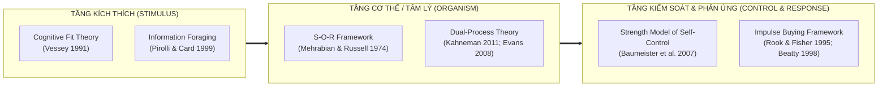

# HỆ THỐNG CÁC LÝ THUYẾT NỀN TẢNG (THEORETICAL FRAMEWORKS COMPENDIUM)
*(Thư viện Tri thức Luận án Tiến sĩ - NCS Lê Phúc Hải | Chuyên ngành: Marketing & Quản trị Kinh doanh)*

---

## 1. TỔNG QUAN HỆ THỐNG LÝ THUYẾT NỀN

Luận án và chuỗi bài báo Scopus Q1 được xây dựng trên sự giao thoa liên ngành giữa **Tâm lý học Hành vi (Behavioral Psychology)**, **Hệ thống Thông tin Quản lý (Management Information Systems - MIS)** và **Hành vi Người tiêu dùng (Consumer Behavior)**. Việc tích hợp đa lý thuyết giúp giải thích toàn diện từ kích thích thuật toán công nghệ, phản ứng nhận thức - cảm xúc nội tại, cho đến cơ chế kiểm soát ức chế hành vi.

---

## 2. NỘI DUNG CHI TIẾT TỪNG LÝ THUYẾT NỀN TẢNG

### 2.1. Khung Lý Thuyết Kích Thích – Cơ Thể – Phản Ứng (Stimulus – Organism – Response - S-O-R)
* **Tác giả khởi xướng**: Mehrabian & Russell (1974); Ứng dụng vào môi trường số bởi Eroglu, Machleit, & Davis (2001) và Verhagen & van Dolen (2011, *Information & Management*).
* **Luận điểm cốt lõi**:
  - Môi trường bên ngoài cung cấp các yếu tố kích thích (*Stimulus - S*).
  - Các kích thích này không dẫn thẳng đến hành vi mà tác động trước hết lên trạng thái nội tại của cá nhân (*Organism - O*), bao gồm cả hai chiều kích: đánh giá nhận thức (Cognitive) và rung cảm cảm xúc (Affective).
  - Trạng thái nội tại đóng vai trò trung gian định hướng các phản ứng hành vi cuối cùng (*Response - R*), thường biểu hiện qua hai xu hướng: tiếp cận (Approach) hoặc né tránh (Avoidance).
* **Ứng dụng vào Luận án**:
  - **S (Kích thích thuật toán AI)**: Đặc tính của hệ thống gợi ý gồm Cá nhân hóa cảm nhận (Perceived Personalization - PP), Độ chính xác cảm nhận (Perceived Accuracy - ACC), và Tính mới mẻ cảm nhận (Perceived Novelty - NOV).
  - **O (Trạng thái tâm lý nội tại)**: Được mô hình hóa thành tiến trình trung gian chuỗi (Serial Mediation) đi từ nhận thức đánh giá hài lòng trong phiên duyệt web (In-process E-Satisfaction - ESAT) đến xung năng cảm xúc bộc phát tức thời (Urge to Buy Impulsively - UBI).
  - **R (Phản ứng hành vi)**: Hành vi mua bốc đồng trực tuyến (Online Impulse Buying - OIB).

---

### 2.2. Mô Hình Năng Lực Tự Kiểm Soát (Strength Model of Self-Control / Ego Depletion Theory)
* **Tác giả khởi xướng**: Baumeister, Bratslavsky, Muraven, & Tice (1998); Hoàn thiện bởi Baumeister, Vohs, & Tice (2007, *Current Directions in Psychological Science*).
* **Luận điểm cốt lõi**:
  - Khả năng tự kiểm soát (Self-Control) của con người hoạt động tương tự như một khối cơ bắp hoặc nguồn năng lượng giới hạn (Limited Resource).
  - Khi đối mặt với các cám dỗ hoặc xung năng bốc phát (Impulsive Urges), vỏ não trước trán kích hoạt tiến trình kiểm soát chủ động để ức chế hành động, cân nhắc hậu quả dài hạn so với thỏa mãn ngắn hạn.
  - Những cá nhân có đặc tính tự kiểm soát cao (Trait Self-Control) sở hữu năng lực điều hòa cảm xúc bền vững, có khả năng ngăn chặn các ham muốn bộc phát chuyển hóa thành hành động chi tiêu sai lệch kế hoạch.
* **Ứng dụng vào Luận án**:
  - Tự kiểm soát (Self-Control - SC) đóng vai trò là **biến điều tiết kìm hãm (Negative Moderator)** ở chặng cuối: $\text{UBI} \rightarrow \text{OIB}$.
  - Lý thuyết giải thích tại sao không phải mọi người tiêu dùng khi cảm thấy thôi thúc (UBI) đều đi đến hành vi mua bốc đồng thực tế (OIB). Khi Self-Control cao, mối quan hệ giữa UBI và OIB bị suy giảm đáng kể.

---

### 2.3. Lý Thuyết Tiến Trình Kép Trong Nhận Thức (Dual-Process Theory)
* **Tác giả tiêu biểu**: Evans (2008); Kahneman (2011, *Thinking, Fast and Slow*); Ứng dụng trong MIS bởi Chen, Lu, Wang, & Pan (2019, *Information & Management*).
* **Luận điểm cốt lõi**:
  - Não bộ con người xử lý thông tin thông qua hai hệ thống tư duy song song:
    - **Hệ thống 1 (Hệ trực giác - Intuitive / Heuristic / Affective)**: Vận hành nhanh, tự động, tiêu tốn ít nỗ lực nhận thức, bị chi phối bởi cảm xúc và sự thích thú tức thời.
    - **Hệ thống 2 (Hệ phân tích - Deliberative / Analytic / Cognitive)**: Vận hành chậm, có ý thức, đòi hỏi nỗ lực tính toán logic và đánh giá chi phí - lợi ích.
* **Ứng dụng vào Luận án**:
  - Thuật toán AI cá nhân hóa và độ chính xác cao giải phóng nỗ lực tìm kiếm của Hệ thống 2, khiến người dùng hạ thấp phòng vệ nhận thức.
  - Cùng lúc đó, các gợi ý mới mẻ (NOV) kích hoạt Hệ thống 1, tạo ra sự thích thú (ESAT) và xung năng mua sắm tự phát (UBI) trước khi Hệ thống 2 kịp can thiệp cân nhắc ngân sách.

---

### 2.4. Lý Thuyết Phù Hợp Nhận Thức (Cognitive Fit Theory)
* **Tác giả khởi xướng**: Vessey (1991, *Information Systems Research*); Ứng dụng vào Recommendation Agents bởi Xiao & Benbasat (2007, 2018, *DSS*).
* **Luận điểm cốt lõi**:
  - Hiệu quả ra quyết định của con người đạt mức tối ưu khi định dạng biểu diễn thông tin của hệ thống máy tính trùng khớp hoàn hảo với cấu trúc nhiệm vụ và mô hình tư duy của người dùng (Cognitive Fit).
  - Khi đạt được sự phù hợp nhận thức, người dùng tiết kiệm tối đa nỗ lực xử lý thông tin (Mental effort), giảm tải áp lực nhận thức (Cognitive overload), và cảm nhận phiên tương tác diễn ra trơn tru, liền mạch.
* **Ứng dụng vào Luận án**:
  - Giải thích cơ chế tác động của **Độ chính xác cảm nhận (ACC)** và **Cá nhân hóa cảm nhận (PP)** lên **Sự hài lòng trong quá trình (ESAT)**.
  - Khi AI đề xuất đúng món hàng khớp nhu cầu tiềm ẩn, sự phù hợp nhận thức xuất hiện ngay lập tức, chuyển hóa thành trải nghiệm thỏa mãn tức thì.

---

### 2.5. Lý Thuyết Tìm Kiếm Thông Tin Tối Ưu (Information Foraging Theory)
* **Tác giả khởi xướng**: Pirolli & Card (1999, *Psychological Review*); Ứng dụng trong thương mại điện tử bởi Ping, Li, & Zhu (2025, *ECR*).
* **Luận điểm cốt lõi**:
  - Con người tìm kiếm thông tin trên không gian số tương tự như động vật săn mồi trong tự nhiên: họ di chuyển theo các "vệt mùi thông tin" (Information Scent) để tối đa hóa lượng thông tin giá trị thu được trên mỗi đơn vị năng lượng/thời gian tiêu hao.
  - Khi một hệ sinh thái cung cấp vệt mùi thông tin hấp dẫn, phong phú và bất ngờ, người dùng sẽ kéo dài thời gian khám phá (Exploration behavior) vượt ra ngoài mục đích ban đầu.
* **Ứng dụng vào Luận án**:
  - Giải thích vai trò của **Tính mới mẻ cảm nhận (NOV)**. Tính mới tạo ra "vệt mùi thông tin" gợi mở, kích thích sự tò mò và chuyển hướng người dùng từ mua sắm có chủ đích sang hành vi mua sắm khám phá đầy ngẫu hứng.
