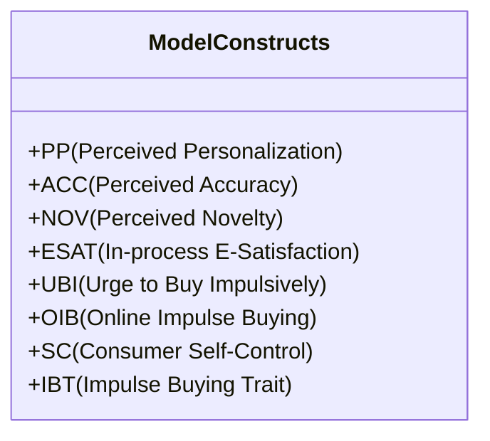

# TỪ ĐIỂN THAO TÁC HÓA BIẾN SỐ & THANG ĐO (VARIABLE OPERATIONALIZATION DICTIONARY)
*(Thư viện Tri thức Luận án Tiến sĩ - NCS Lê Phúc Hải | Song ngữ Anh - Việt | Chuẩn Trắc lượng Tâm lý)*

---

## 1. NGUYÊN TẮC THIẾT KẾ THANG ĐO

1. **Thang đo Likert 7 điểm (7-point Likert Scale)**:
   - Đi từ $1 = \text{"Hoàn toàn không đồng ý" (Strongly Disagree)}$ đến $7 = \text{"Hoàn toàn đồng ý" (Strongly Agree)}$.
   - Tối ưu hóa độ nhạy biến thiên phương sai và giảm sai số đo lường so với thang 5 điểm (Hair et al., 2022).
2. **Quy chuẩn thích ứng & dịch ngược (Back-Translation Protocol)**:
   - Bản gốc tiếng Anh từ các công trình Scopus Q1 đầu ngành.
   - Biên dịch song song Anh – Việt và dịch ngược độc lập bởi 2 chuyên gia ngôn ngữ để bảo toàn nguyên vẹn tính tương đương khái niệm (Conceptual Equivalence).
3. **Tiêu chuẩn kiểm định trắc lượng (Psychometric Cut-offs)**:
   - Hệ số tin cậy nội tại Cronbach's Alpha ($\alpha \ge 0.70$, lý tưởng $\ge 0.80$).
   - Độ tin cậy tổng hợp Composite Reliability ($CR \ge 0.70$).
   - Phương sai trích trung bình Average Variance Extracted ($AVE \ge 0.50$).
   - Hệ số tải ngoài (Outer Factor Loadings $\lambda \ge 0.708$).
   - Giá trị phân biệt Heterotrait-Monotrait Ratio ($\text{HTMT} < 0.85$ hoặc $< 0.90$).

---

## 2. BẢNG TỪ ĐIỂN THAO TÁC HÓA CHI TIẾT 8 CẤU NIỆM

---

### 2.1. CÁC BIẾN ĐỘC LẬP / KÍCH THÍCH AI (STIMULI)

#### Cấu niệm 1: Cá nhân hóa cảm nhận (Perceived Personalization - PP)
* **Định nghĩa khái niệm**: Mức độ người tiêu dùng nhận thức rằng các gợi ý sản phẩm do hệ thống thuật toán đề xuất phản ánh chuẩn xác sở thích, thị hiếu và thói quen mua sắm riêng biệt của chính họ (Shanahan et al., 2019).
* **Nguồn thang đo**: Thích ứng từ Shanahan, Tran, & Taylor (2019, *Journal of Retailing and Consumer Services*).
* **Các mục hỏi đo lường (Items)**:
  - `PP1`: "The recommendations provided by this e-commerce platform reflect my personal tastes and shopping preferences." *(Các gợi ý do sàn thương mại điện tử này cung cấp phản ánh đúng thị hiếu và sở thích mua sắm cá nhân của tôi).*
  - `PP2`: "The platform provides product suggestions that feel customized specifically for me." *(Sàn thương mại điện tử đưa ra các đề xuất sản phẩm đem lại cho tôi cảm giác được tùy biến dành riêng cho cá nhân tôi).*
  - `PP3`: "I feel that the recommendation algorithm understands the types of products I am interested in." *(Tôi cảm thấy thuật toán đề xuất hiểu rõ những nhóm sản phẩm mà tôi đang quan tâm).*
  - `PP4`: "The recommended products match my individual shopping requirements closely." *(Các sản phẩm được gợi ý phù hợp chặt chẽ với nhu cầu mua sắm riêng của tôi).*
* **Trắc lượng chuẩn y văn**: $\alpha = 0.912$, $CR = 0.915$, $AVE = 0.730$.

---

#### Cấu niệm 2: Độ chính xác cảm nhận (Perceived Accuracy - ACC)
* **Định nghĩa khái niệm**: Mức độ người tiêu dùng đánh giá rằng hệ thống đề xuất đưa ra các sản phẩm chuẩn xác, đúng đắn và có độ tin cậy cao so với tiêu chí tìm kiếm thực tế (Al-Natour et al., 2011).
* **Nguồn thang đo**: Thích ứng từ Al-Natour, Benbasat, & Cenfetelli (2011, *JAIS*).
* **Các mục hỏi đo lường (Items)**:
  - `ACC1`: "The recommendations generated by the system accurately match what I am looking for." *(Các gợi ý do hệ thống tạo ra khớp chính xác với những gì tôi đang tìm kiếm).*
  - `ACC2`: "The recommendations provided by the platform are correct and relevant to my criteria." *(Các gợi ý từ nền tảng là đúng đắn và phù hợp với tiêu chí của tôi).*
  - `ACC3`: "The recommendation feature rarely suggests irrelevant or wrong products." *(Tính năng đề xuất hiếm khi gợi ý các sản phẩm lạc đề hoặc sai lệch).*
* **Trắc lượng chuẩn y văn**: $\alpha = 0.884$, $CR = 0.890$, $AVE = 0.672$.

---

#### Cấu niệm 3: Tính mới mẻ cảm nhận (Perceived Novelty - NOV)
* **Định nghĩa khái niệm**: Mức độ người tiêu dùng nhận thấy các sản phẩm do hệ thống đề xuất mang lại sự bất ngờ, khám phá mới mẻ, và gợi mở những ý tưởng sản phẩm mà họ chưa từng nghĩ tới trước đó (Ping et al., 2025; Zhang et al., 2021).
* **Nguồn thang đo**: Thích ứng từ Ping, Li, & Zhu (2025, *Electronic Commerce Research*) và Zhang et al. (2021).
* **Các mục hỏi đo lường (Items)**:
  - `NOV1`: "The recommendation system suggested items that I had never seen or thought of before." *(Hệ thống đề xuất gợi ý những món hàng mà tôi chưa từng thấy hoặc chưa từng nghĩ tới trước đây).*
  - `NOV2`: "I discovered novel and unexpected products through the recommendations on this platform." *(Tôi khám phá ra những sản phẩm mới mẻ và bất ngờ thông qua các gợi ý trên nền tảng này).*
  - `NOV3`: "The recommended items gave me a pleasant feeling of novelty and discovery." *(Các sản phẩm được đề xuất đem lại cho tôi cảm giác mới lạ và thích thú khám phá).*
* **Trắc lượng chuẩn y văn**: $\alpha = 0.865$, $CR = 0.871$, $AVE = 0.693$.

---

### 2.2. CÁC BIẾN TRUNG GIAN CHUỖI / TÂM LÝ (ORGANISMS)

#### Cấu niệm 4: Sự hài lòng trong quá trình (In-process E-Satisfaction - ESAT)
* **Định nghĩa khái niệm**: Trạng thái thỏa mãn nhận thức và cảm xúc tích cực xuất hiện ngay trong phiên duyệt web và tương tác với các tính năng đề xuất của sàn thương mại điện tử, xảy ra trước khi có quyết định thanh toán cuối cùng (Xiao & Benbasat, 2018; Anderson & Srinivasan, 2003).
* **Nguồn thang đo**: Thích ứng từ Xiao & Benbasat (2018, *DSS*) và Anderson & Srinivasan (2003).
* **Các mục hỏi đo lường (Items)**:
  - `ESAT1`: "I am thoroughly satisfied with my browsing experience while exploring these recommendations." *(Tôi hoàn toàn hài lòng với trải nghiệm duyệt web của mình khi khám phá các gợi ý này).*
  - `ESAT2`: "The interaction with the recommendation features gives me a high level of satisfaction." *(Việc tương tác với các tính năng đề xuất đem lại cho tôi mức độ thỏa mãn cao).*
  - `ESAT3`: "Overall, my experience with the product recommendations on this platform is very pleasing." *(Nhìn chung, trải nghiệm của tôi với các đề xuất sản phẩm trên nền tảng này rất thú vị và hài lòng).*
* **Trắc lượng chuẩn y văn**: $\alpha = 0.895$, $CR = 0.902$, $AVE = 0.754$.

---

#### Cấu niệm 5: Sự thôi thúc mua bốc đồng (Urge to Buy Impulsively - UBI)
* **Định nghĩa khái niệm**: Trạng thái thôi thúc tâm lý đột ngột, mãnh liệt và kéo theo sự kích thích cảm xúc tức thì muốn sở hữu sản phẩm ngay lập tức sau khi nhìn thấy các gợi ý của thuật toán AI (Beatty & Ferrell, 1998; Badgaiyan & Verma, 2015).
* **Nguồn thang đo**: Thích ứng từ Beatty & Ferrell (1998, *Journal of Retailing*) và Badgaiyan & Verma (2015, *JRCS*).
* **Các mục hỏi đo lường (Items)**:
  - `UBI1`: "While browsing the recommendations, I felt a sudden urge to buy something." *(Trong lúc xem các gợi ý, tôi cảm thấy một sự thôi thúc đột ngột muốn mua một món đồ nào đó).*
  - `UBI2`: "I had a strong desire to buy recommended products that were not on my planned shopping list." *(Tôi có khao khát mãnh liệt muốn mua những sản phẩm được gợi ý vốn không nằm trong danh sách dự định mua sắm của tôi).*
  - `UBI3`: "I experienced a strong urge to make an immediate purchase upon seeing these suggestions." *(Tôi trải qua một cảm giác thôi thúc mạnh mẽ muốn mua ngay lập tức khi nhìn thấy các gợi ý này).*
* **Trắc lượng chuẩn y văn**: $\alpha = 0.879$, $CR = 0.885$, $AVE = 0.720$.

---

### 2.3. BIẾN PHỤ THUỘC / PHẢN ỨNG HÀNH VI (RESPONSE)

#### Cấu niệm 6: Hành vi mua bốc đồng trực tuyến (Online Impulse Buying - OIB)
* **Định nghĩa khái niệm**: Hành vi thực tế mua một hoặc nhiều sản phẩm trên sàn thương mại điện tử diễn ra một cách tự phát, tức thời, không có kế hoạch từ trước, chịu tác động trực tiếp từ sự thôi thúc khi nhìn thấy gợi ý AI (Rook & Fisher, 1995; Verhagen & van Dolen, 2011).
* **Nguồn thang đo**: Thích ứng từ Rook & Fisher (1995, *JCR*) và Verhagen & van Dolen (2011, *Information & Management*).
* **Các mục hỏi đo lường (Items)**:
  - `OIB1`: "I often buy products recommended by the platform without prior planning." *(Tôi thường mua những sản phẩm do nền tảng gợi ý mà không hề có kế hoạch tính toán từ trước).*
  - `OIB2`: "I ended up purchasing items suggested by the AI algorithm that I had not originally intended to buy." *(Tôi đã tiến hành mua những món hàng do thuật toán AI gợi ý mà ban đầu tôi không hề có ý định mua).*
  - `OIB3`: "My purchase of recommended products was largely spontaneous." *(Việc tôi mua các sản phẩm được đề xuất phần lớn mang tính tự phát).*
* **Trắc lượng chuẩn y văn**: $\alpha = 0.887$, $CR = 0.893$, $AVE = 0.735$.

---

### 2.4. BIẾN ĐIỀU TIẾT & BIẾN KIỂM SOÁT (MODERATOR & CONTROL)

#### Cấu niệm 7: Khả năng tự kiểm soát của người tiêu dùng (Consumer Self-Control - SC)
* **Định nghĩa khái niệm**: Năng lực nhận thức và ý chí chủ động của cá nhân trong việc kìm nén các xung năng bộc phát, ức chế ham muốn chi tiêu không mong muốn, và tuân thủ các mục tiêu tài chính dài hạn (Tangney et al., 2004; Baumeister et al., 2007).
* **Nguồn thang đo**: Thích ứng từ Brief Self-Control Scale (BSCS - Tangney, Baumeister, & Boone, 2004, *Journal of Personality*).
* **Các mục hỏi đo lường (Items)**:
  - `SC1`: "I am good at resisting impulsive shopping temptations when browsing online." *(Tôi có khả năng cưỡng lại tốt trước những cám dỗ mua sắm bốc đồng khi lướt mạng).*
  - `SC2`: "I can easily stop myself from making unplanned purchases even when the offers look attractive." *(Tôi có thể dễ dàng kìm hãm bản thân không mua hàng phi kế hoạch ngay cả khi các gợi ý trông rất hấp dẫn).*
  - `SC3`: "I keep my shopping budget and long-term financial goals in mind before finalizing an order." *(Tôi luôn ghi nhớ ngân sách mua sắm và mục tiêu tài chính dài hạn của mình trước khi bấm thanh toán đơn hàng).*
* **Trắc lượng chuẩn y văn**: $\alpha = 0.852$, $CR = 0.860$, $AVE = 0.672$.

---

#### Cấu niệm 8: Khuynh hướng mua bốc đồng (Impulse Buying Trait - IBT - Biến kiểm soát)
* **Định nghĩa khái niệm**: Nét tính cách tiêu dùng bền vững đặc trưng bởi xu hướng thường xuyên mua sắm theo cảm hứng nhất thời trong cuộc sống hàng ngày (Rook & Fisher, 1995).
* **Nguồn thang đo**: Rook & Fisher (1995, *Journal of Consumer Research*).
* **Các mục hỏi đo lường (Items)**:
  - `IBT1`: "I often buy things spontaneously in my daily life." *(Tôi thường mua sắm một cách ngẫu hứng trong đời sống hàng ngày).*
  - `IBT2`: "'Just buy it' describes the way I generally shop." *('Thích là mua' mô tả đúng thói quen mua sắm thông thường của tôi).*
  - `IBT3`: "I frequently buy items according to how I feel at that exact moment." *(Tôi thường xuyên mua hàng dựa theo cảm xúc bộc phát ngay tại thời điểm đó).*
* **Trắc lượng chuẩn y văn**: $\alpha = 0.868$, $CR = 0.875$, $AVE = 0.701$.
