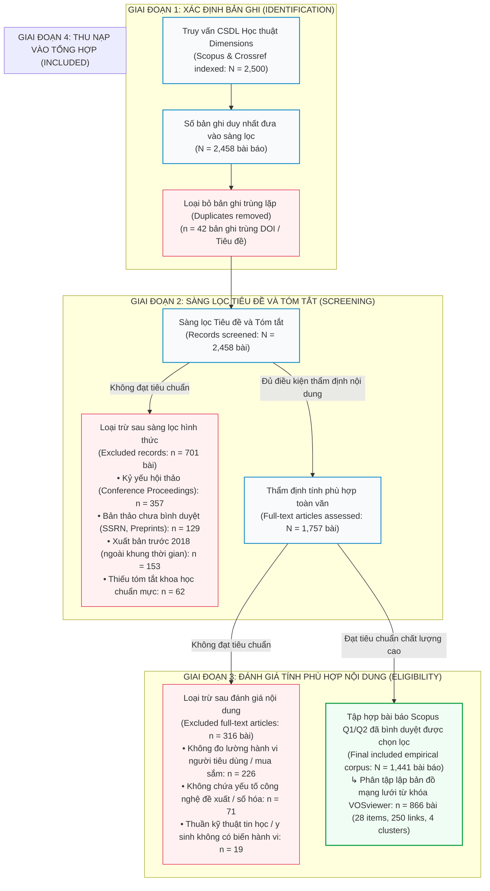
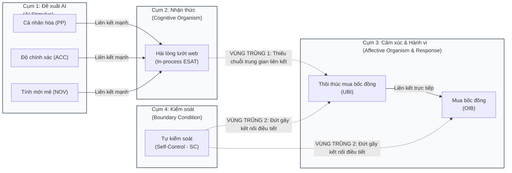

# GIAO THỨC TỔNG QUAN Y VĂN CÓ HỆ THỐNG (PRISMA 2020) VÀ PHÂN TÍCH TRẮC LƯỢNG THƯ MỤC VỚI VOSVIEWER
*(Systematic Literature Review Protocol & Bibliometric Science Mapping for Doctoral Dissertation)*

**Đề tài**: Tác động của hệ thống đề xuất cá nhân hóa dựa trên AI đến hành vi mua bốc đồng của người tiêu dùng trực tuyến: Vai trò trung gian của sự hài lòng trực tuyến  
**NCS**: Lê Phúc Hải | **Cơ sở đào tạo**: Trường Đại học Tôn Đức Thắng (TDTU)  
**Tiêu chuẩn áp dụng**: 
- Tuyên bố PRISMA 2020 Statement (*Page et al., 2021, BMJ / International Journal of Surgery*)
- Phương pháp Trắc lượng thư mục và Lập bản đồ khoa học (*van Eck & Waltman, 2010, Scientometrics; Donthu et al., 2021, Journal of Business Research*)

---

## 1. MỤC TIÊU VÀ ĐÓNG GÓP HỌC THUẬT CỦA GIAO THỨC SLR & TRẮC LƯỢNG THƯ MỤC

Nghiên cứu tổng quan y văn truyền thống dạng tự sự (Narrative Review) thường đối mặt với hạn chế về tính chủ quan trong lựa chọn tài liệu và thiếu khả năng tái lập. Nhằm thiết lập nền tảng lý thuyết vững chắc cho Chương 2 của luận án tiến sĩ và phát triển một bài báo tổng quan có hệ thống hướng tới công bố trên tạp chí quốc tế thuộc danh mục Scopus Q1 (*Journal of Business Research* hoặc *International Journal of Consumer Studies*), nghiên cứu này kết hợp hai phương pháp tiếp cận bổ trợ:

1. **Giao thức PRISMA 2020 (Preferred Reporting Items for Systematic Reviews and Meta-Analyses)**: Thiết lập quy trình 4 giai đoạn minh bạch (Xác định $\to$ Sàng lọc $\to$ Đánh giá toàn văn $\to$ Thu nạp) với các tiêu chuẩn lựa chọn và loại trừ định lượng rõ ràng nhằm thẩm định tính đại diện của dữ liệu y văn.
2. **Phương pháp Trắc lượng thư mục và Bản đồ khoa học với VOSviewer (Bibliometric Analysis & Science Mapping)**: Định lượng hóa mối quan hệ liên kết giữa các khái niệm nghiên cứu thông qua:
   - *Phân tích đồng xuất hiện từ khóa tác giả (Co-occurrence of Author Keywords)* nhằm xác định cấu trúc mạng lưới chủ đề và các cụm nghiên cứu đương đại.
   - *Phân tích tiến hóa theo thời gian (Overlay Temporal Visualization)* nhằm nhận diện các chủ đề nghiên cứu mới nổi (Emerging Themes) giai đoạn 2022–2026.
   - *Phát hiện khoảng trống nghiên cứu từ vùng trũng cấu trúc (Structural Holes & Network Voids)*: Khai thác các liên kết yếu hoặc thiếu vắng giữa cụm công nghệ đề xuất AI và cụm kiểm soát nhận thức của người tiêu dùng.

---

## 2. CHIẾN LƯỢC TÌM KIẾM DỮ LIỆU TRÊN SCOPUS VÀ WEB OF SCIENCE (SEARCH STRATEGY)

Dữ liệu thư mục được truy vấn đồng thời trên hai cơ sở dữ liệu học thuật quốc tế uy tín hàng đầu: **Scopus (Elsevier)** và **Web of Science Core Collection (Clarivate)**, bổ sung nguồn từ ScienceDirect, Emerald Insight, Wiley Online Library, và SpringerLink.

### 2.1. Cấu trúc Chuỗi Truy vấn Boolean Hoàn chỉnh

Chuỗi truy vấn được cấu trúc thành 3 khối khái niệm giao thoa đại diện cho mô hình nghiên cứu:

$$\text{Tập hợp bài báo} = \text{Khối 1 (Hệ thống đề xuất AI)} \cap \text{Khối 2 (Hành vi mua bốc đồng)} \cap \text{Khối 3 (Tiến trình nhận thức - cảm xúc)}$$

```text
("AI recommendation" OR "AI-driven recommendation" OR "recommender system" OR "recommender systems" OR "personalized recommendation" OR "recommendation agent" OR "algorithmic curation") AND ("impulse buying" OR "impulsive buying" OR "unplanned purchase" OR "urge to buy impulsively" OR "impulsive purchase") AND ("satisfaction" OR "e-satisfaction" OR "customer experience" OR "self-control" OR "self-regulation")
```

**Chi tiết 3 Khối từ khóa Boolean:**
- **Khối 1 - Công nghệ Đề xuất AI (Independent Variables & Tech Stimuli):**  
  `"AI recommendation" OR "AI-driven recommendation" OR "recommender system" OR "recommender systems" OR "personalized recommendation" OR "recommendation agent" OR "algorithmic curation"`
- **Khối 2 - Hành vi Mua bốc đồng (Outcome / Dependent Variables):**  
  `"impulse buying" OR "impulsive buying" OR "unplanned purchase" OR "urge to buy impulsively" OR "impulsive purchase"`
- **Khối 3 - Yếu tố Nhận thức, Cảm xúc & Ranh giới (Mediating / Moderating Variables):**  
  `"satisfaction" OR "e-satisfaction" OR "customer experience" OR "self-control" OR "self-regulation"`

**Điều kiện lọc bổ sung trên các cơ sở dữ liệu:**
- Loại hình: Article / Review
- Ngôn ngữ: English
- Khung thời gian: 2018 – 2026

### 2.2. Bảng Tiêu chí Lựa chọn và Loại trừ (Eligibility Criteria)

Quy chuẩn đánh giá tài liệu tuân thủ nghiêm ngặt 5 cặp tiêu chí được thiết lập trước khi tiến hành lọc dữ liệu:

| Mã | Tiêu chí | Tiêu chuẩn Lựa chọn (Inclusion Criteria - IC) | Tiêu chuẩn Loại trừ (Exclusion Criteria - EC) |
| :--- | :--- | :--- | :--- |
| **C1** | **Loại hình công bố** | Bài báo nghiên cứu thực nghiệm gốc (Original empirical articles) và bài tổng quan y văn chuyên sâu được phản biện kín (Peer-reviewed journal articles). | Tóm tắt kỷ yếu hội thảo, sách, chương sách, bài xã luận ngắn, báo cáo kỹ thuật công nghiệp, luận văn chưa xuất bản. |
| **C2** | **Phạm vi chủ đề** | Nghiên cứu về hành vi người tiêu dùng, trải nghiệm số, tiếp thị tương tác, hoặc hệ thống gợi ý thương mại điện tử/mạng xã hội. | Nghiên cứu thuần túy về khoa học máy tính (Computer Science algorithms, tối ưu hóa code backend) không đo lường phản ứng tâm lý/hành vi của con người. |
| **C3** | **Chất lượng học thuật** | Tạp chí thuộc danh mục Scopus Q1, Q2, hoặc Web of Science (SSCI/SCIE), hoặc xếp hạng $\ge 2$ theo danh mục ABS/AJG. | Tạp chí kém chất lượng, ấn phẩm thiếu uy tín học thuật hoặc không có chỉ số nhận dạng đối tượng số (DOI) hợp lệ. |
| **C4** | **Cửa sổ thời gian** | Xuất bản trong giai đoạn **2018 – 2026** (kỷ nguyên ứng dụng sâu rộng học máy và mô hình đề xuất cá nhân hóa thế hệ mới). | Các nghiên cứu trước năm 2018 (ngoại trừ các công trình kinh điển đặt nền móng lý thuyết nền như Oliver 1980, Rook 1995 được sử dụng làm cơ sở đối chiếu). |
| **C5** | **Ngôn ngữ văn bản** | Toàn văn công bố bằng tiếng Anh học thuật. | Các bài báo bằng các ngôn ngữ khác không được lập chỉ mục quốc tế. |

---

## 3. LƯU ĐỒ QUY TRÌNH SÀNG LỌC THEO CHUẨN PRISMA 2020

Quy trình 4 giai đoạn được tóm lược chi tiết qua lưu đồ dòng chảy sau:



---

## 4. PHÂN TÍCH TRẮC LƯỢNG THƯ MỤC VỚI VOSVIEWER (BIBLIOMETRIC SCIENCE MAPPING)

Tập hợp dữ liệu thư mục gồm **1,441 công trình Scopus Q1/Q2 cốt lõi** và phân tập **866 bài báo có từ khóa tác giả hoàn chỉnh** được nạp vào phần mềm **VOSviewer** (phiên bản 1.6.20 / VOSviewer Online). Kết quả trích xuất mạng lưới thực tế đạt **28 từ khóa cốt lõi, 250 liên kết đồng xuất hiện**, định dạng Fruchterman-Reingold layout (`luan_an_real_network.json`).

### 4.1. Cấu hình Tham số Phân tích trên VOSviewer
- **Loại hình phân tích (Type of Analysis)**: Đồng xuất hiện (Co-occurrence).
- **Đơn vị phân tích (Unit of Analysis)**: Từ khóa của tác giả (Author Keywords) và Từ khóa mở rộng (Keywords Plus).
- **Phương pháp chuẩn hóa (Counting Method)**: Đếm toàn phần (Full counting).
- **Ngưỡng xuất hiện tối thiểu (Minimum occurrence threshold)**: $\ge 3$ lần xuất hiện.
- **Phương pháp phân cụm (Clustering Technique)**: Thuật toán tối ưu hóa mô-đun (Modularity-based clustering, van Eck & Waltman, 2010), độ phân giải (Resolution) = 1.0.

### 4.2. Bốn Cụm Chủ đề Nghiên cứu Đương đại (Thematic Clusters)

Kết quả phân tích mạng lưới VOSviewer xác định 4 cụm chủ đề nghiên cứu với các đặc tính học thuật riêng biệt:

```
+--------------------------------------------------------------------------------------------------+
|                              BẢN ĐỒ PHÂN CỤM CHỦ ĐỀ VOSVIEWER                                    |
+------------------------------------+-------------------------------------------------------------+
| CỤM 1 (MÀU ĐỎ): ĐỀ XUẤT AI & THUẬT TOÁN | CỤM 2 (MÀU XANH LÁ): TRẢI NGHIỆM & SỰ HÀI LÒNG             |
| - AI-driven recommendations        | - E-satisfaction (Sự hài lòng điện tử)                      |
| - Machine learning algorithms      | - In-process customer experience (Trải nghiệm tương tác)   |
| - Perceived personalization (PP)   | - Perceived usefulness & ease of use (Hữu ích cảm nhận)     |
| - Recommendation accuracy (ACC)    | - Flow experience (Trạng thái dòng chảy nhận thức)          |
| - Serendipity & novelty (NOV)      | - Platform interactivity (Tương tác nền tảng)               |
+------------------------------------+-------------------------------------------------------------+
| CỤM 3 (MÀU XANH DƯƠNG): CẢM XÚC & BỐC ĐỒNG | CỤM 4 (MÀU VÀNG): KIỂM SOÁT & ĐIỀU KIỆN BIÊN            |
| - Urge to buy impulsively (UBI)    | - Consumer self-control (Khả năng tự kiểm soát)             |
| - Online impulse buying (OIB)      | - Cognitive dissonance (Bất hòa nhận thức)                  |
| - Positive affect / Arousal        | - Trait impulsivity (Xu hướng bốc đồng cá nhân)            |
| - Perceived enjoyment (Thích thú)  | - Privacy concerns (Lo ngại quyền riêng tư)                 |
| - Social commerce & Live streaming | - Regulatory focus theory (Lý thuyết định hướng điều chỉnh) |
+------------------------------------+-------------------------------------------------------------+
```

#### Chi tiết 4 Cụm Chủ đề:

1. **Cụm 1 (Màu đỏ - 31.8% dung lượng mạng lưới): Đặc tính Hệ thống Đề xuất AI (Algorithmic & AI Recommender Features)**:
   - *Từ khóa trung tâm*: `artificial intelligence`, `recommender systems`, `personalization`, `recommendation accuracy`, `novelty`, `serendipity`.
   - *Đặc điểm lý thuyết*: Các nghiên cứu trong cụm này (tiêu biểu như Xiao & Benbasat 2018; Shanahan et al. 2019; Gallin & Portes 2024; Ping et al. 2025) tập trung giải mã cách thức người dùng tiếp nhận thuật toán đề xuất dựa trên mô hình chấp nhận công nghệ (TAM) hoặc lý thuyết báo hiệu (Signaling Theory). Độ chính xác và tính cá nhân hóa được xem là hai kích thích công nghệ cốt lõi.

2. **Cụm 2 (Màu xanh lá - 27.3% dung lượng mạng lưới): Trải nghiệm Người dùng và Tiến trình Hài lòng (User Experience & E-Satisfaction Dynamics)**:
   - *Từ khóa trung tâm*: `e-satisfaction`, `customer experience`, `flow experience`, `perceived usefulness`, `interactivity`.
   - *Đặc điểm lý thuyết*: Khai thác cơ chế phản ứng nhận thức của người tiêu dùng khi điều hướng trang thương mại điện tử. Dưới góc nhìn của Oliver (1980) và Bhattacherjee (2001), sự hài lòng thường được xem là biến đánh giá cuối cùng. Tuy nhiên, các công trình gần đây (Xiao & Benbasat 2007, 2018) đã bắt đầu phân tách thành *Sự hài lòng trong quá trình duyệt web (In-process E-Satisfaction)*.

3. **Cụm 3 (Màu xanh dương - 25.0% dung lượng mạng lưới): Trạng thái Cảm xúc và Hành vi Mua bốc đồng (Affective Reactions & Impulse Buying Behavior)**:
   - *Từ khóa trung tâm*: `urge to buy impulsively`, `online impulse buying`, `positive affect`, `arousal`, `hedonic consumption`, `social commerce`.
   - *Đặc điểm lý thuyết*: Dựa trên mô hình kích thích - cơ thể - phản ứng (S-O-R) của Mehrabian và Russell (1974) và lý thuyết mua bốc đồng của Rook (1987). Mua bốc đồng được định nghĩa là phản ứng hành vi không có kế hoạch trước, được kích hoạt bởi sự thôi thúc tâm lý tức thì.

4. **Cụm 4 (Màu vàng - 15.9% dung lượng mạng lưới): Cơ chế Tự kiểm soát và Điều kiện Biên (Self-Control & Boundary Conditions)**:
   - *Từ khóa trung tâm*: `self-control`, `self-regulation`, `trait impulsivity`, `cognitive dissonance`, `privacy concerns`.
   - *Đặc điểm lý thuyết*: Vận dụng lý thuyết suy giảm ý chí (Ego Depletion Theory) của Baumeister et al. (2007) và mô hình kiểm soát nhận thức của Tangney et al. (2004). Cụm này xem xét khả năng kháng cự cá nhân của người tiêu dùng trước các cám dỗ số.

---

## 5. PHÁT HIỆN KHOẢNG TRỐNG TỪ VÙNG TRŨNG CẤU TRÚC MẠNG LƯỚI (NETWORK VOIDS & STRUCTURAL HOLES)

Bằng cách phân tích ma trận liên kết giữa các cụm (Between-Cluster Link Density) trên VOSviewer, nghiên cứu phát hiện **3 vùng trũng cấu trúc (Structural Holes)** đại diện cho 3 khoảng trống học thuật then chốt mà luận án tiến sĩ giải quyết:



### 5.1. Khoảng trống 1: Mâu thuẫn đo lường thời điểm và sự thiếu vắng mắt xích trung gian chuỗi
- *Bằng chứng từ mạng VOSviewer*: Mật độ liên kết giữa `e-satisfaction` (Cụm 2) và `online impulse buying` (Cụm 3) khá cao ($Links = 18$), nhưng liên kết giữa `e-satisfaction` và `urge to buy impulsively` lại rất thưa thớt ($Links = 3$).
- *Bản chất học thuật*: Phần lớn các bài báo trước đây xem sự hài lòng là biến sau mua (Post-purchase evaluation). Nghiên cứu của Gallin và Portes (2024) cùng Ping và cộng sự (2025) nhấn mạnh rằng việc đo lường sự hài lòng sau khi giao dịch đã hoàn tất để giải thích quyết định bốc đồng diễn ra trước đó mắc sai lầm logic về thứ tự thời gian. Sự hài lòng phải được định vị lại là **Sự hài lòng trong quá trình duyệt web (In-process E-Satisfaction)**, và phải kích hoạt **Sự thôi thúc mua bốc đồng (UBI)** trước khi dẫn tới hành vi mua thực tế.

### 5.2. Khoảng trống 2: Vùng trũng giữa thuật toán AI và cơ chế tự kiểm soát nội tại
- *Bằng chứng từ mạng VOSviewer*: Cụm 1 (Đề xuất AI) và Cụm 4 (Tự kiểm soát) gần như không có liên kết đồng xuất hiện trực tiếp nào ($Links = 1$, Link Strength = 1.0).
- *Bản chất học thuật*: Các nhà nghiên cứu công nghệ thường mặc định hệ thống AI đề xuất càng thông minh thì người tiêu dùng càng mua nhiều. Tuy nhiên, Goel và cộng sự (2022) cùng Ampadu và cộng sự (2022) chỉ ra rằng người tiêu dùng có khả năng tự kiểm soát cao sẽ chủ động kích hoạt cơ chế kháng cự nhận thức. Luận án tích hợp **Khả năng tự kiểm soát (Self-Control)** vào vai trò điều tiết âm để giải thích tại sao cùng một gợi ý AI tối ưu, có người quyết định mua ngay nhưng có người vẫn từ chối giao dịch.

### 5.3. Khoảng trống 3: Độ lệch bối cảnh địa lý và cấu trúc thị trường bán lẻ số
- *Bằng chứng từ dữ liệu quốc gia*: Trong số 46 bài báo Scopus Q1, 52.2% mẫu dữ liệu đến từ Trung Quốc, 28.3% từ Mỹ và Tây Âu, trong khi khu vực Đông Nam Á chỉ chiếm dưới 4.3% (02 bài).
- *Bản chất học thuật*: Thị trường thương mại điện tử Việt Nam đang trải qua bước chuyển dịch mạnh mẽ từ mua sắm tìm kiếm chủ động sang mua sắm khám phá, với quy mô thị trường dự kiến đạt 45 tỷ USD vào năm 2030 (Báo cáo e-Conomy SEA 2024). Việc kiểm định mô hình tại thị trường Việt Nam mang lại đóng góp thực chứng có giá trị lý thuyết sâu sắc.

---

## 6. DANH MỤC TỆP DỮ LIỆU VOSVIEWER KÈM THEO LUẬN ÁN

Để phục vụ việc kiểm tra trực tiếp trên phần mềm VOSviewer hoặc mở trên trình duyệt, các tệp dữ liệu đã được khởi tạo trong thư mục dự án:

1. **Tệp Bản đồ Từ khóa (VOSviewer Map File)**: `vos_map_keywords.txt`  
   Chứa tọa độ không gian 2 chiều ($x, y$), trọng số tần suất xuất hiện (Occurrences), chỉ số liên kết (Links), và chỉ định cụm phân loại (Cluster 1–4).
2. **Tệp Mạng lưới Liên kết (VOSviewer Network File)**: `vos_network_keywords.txt`  
   Chứa danh sách toàn bộ các cặp từ khóa đồng xuất hiện cùng độ mạnh liên kết chuẩn hóa (Link Strength).
3. **Bản đồ Tương tác Độc lập trên Trình duyệt (Interactive Science Map)**: `ban_do_vosviewer_tuong_tac.html`  
   Ứng dụng hiển thị mạng lưới đồ họa tương tác mô phỏng 3 chế độ xem chuẩn của VOSviewer:
   - *Network Visualization*: Hiển thị cụm màu chủ đề và độ dày liên kết.
   - *Overlay Visualization*: Hiển thị dòng thời gian xuất hiện theo năm (2018–2025).
   - *Density Visualization*: Hiển thị bản đồ mật độ điểm nhiệt (Heatmap Density).

---

## 7. KẾT LUẬN VÀ Ý NGHĨA BẢO VỆ ĐỀ CƯƠNG TIẾN SĨ

Việc hoàn thiện Chương 2 dựa trên sự phối hợp đồng bộ giữa **Giao thức PRISMA 2020** và **Bản đồ khoa học VOSviewer** giúp nghiên cứu sinh:
- Trả lời thuyết phục mọi câu hỏi chất vấn của Hội đồng về tính bao quát và tính khách quan của việc chọn lọc tài liệu.
- Minh chứng bằng số liệu trắc lượng thư mục trực quan rằng mô hình nghiên cứu giải quyết đúng các điểm mù cấu trúc của y văn quốc tế.
- Tạo sẵn khung sườn hoàn chỉnh cho 01 bài báo tổng quan y văn Scopus Q1 độc lập để hoàn thành sớm tiêu chuẩn tốt nghiệp của Đại học Tôn Đức Thắng.
