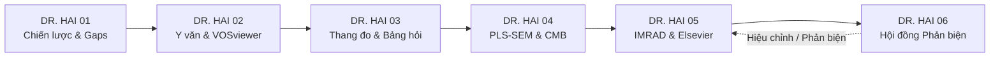

# BÁO CÁO ĐÁNH GIÁ TOÀN DIỆN WORKFLOW VÀ TƯ VẤN NÂNG CẤP CHIẾN LƯỢC
## H-AI ResearchLAB (Autonomous Doctoral Research & Publication Engine)

**Nghiên cứu sinh:** Lê Phúc Hải  
**Đơn vị:** Trường Đại học Tôn Đức Thắng (TDTU) - Chuyên ngành Marketing & Quản trị Kinh doanh  
**Đề tài luận án:** *Tác động của hệ thống đề xuất cá nhân hóa dựa trên AI đến hành vi mua bốc đồng của người tiêu dùng trực tuyến: Vai trò trung gian của sự hài lòng trực tuyến*  
*(The Impact of AI-Driven Personalized Recommendation Systems on Online Consumer Impulse Buying Behavior: The Mediating Role of E-Satisfaction)*  
**Hệ thống điều hành:** H-AI ResearchLAB (6 Phân thân Chuyên gia: `DR. HAI 01` $\rightarrow$ `DR. HAI 06`)

---

## I. MA TRẬN ĐÁNH GIÁ TOÀN DIỆN HIỆN TRẠNG WORKFLOW (AUDIT MATRIX)

Chúng tôi tiến hành thẩm định độc lập quy trình nghiên cứu khép kín từ khâu Ý tưởng $\rightarrow$ Tổng quan $\rightarrow$ Phương pháp $\rightarrow$ Phân tích Dữ liệu $\rightarrow$ Soạn thảo $\rightarrow$ Phản biện Tạp chí dựa trên 4 trụ cột học thuật quốc tế:

### 1. Điểm mạnh vượt trội đã thiết lập (Key Strengths)
1. **Kiến trúc Luận án Tích lũy (Cumulative Dissertation) hoàn chỉnh:**
   - Đã chia nhỏ đề tài thành 4 bài báo độc lập tương ứng 1:1 với 4 Chương luận án (Paper 1: SLR $\to$ Chương 2; Paper 2: Mediation $\to$ Chương 3 & 4; Paper 3: Moderation $\to$ Chương 4; Paper 4: fsQCA $\to$ Chương 4 & 5).
2. **Kế thừa tinh hoa từ các Repo AI hàng đầu thế giới:**
   - Stanford STORM (Debate đa góc nhìn tâm lý - công nghệ), PaperQA / GPT-Researcher (Recursive academic search & Crossref API), Sakana AI Scientist (LaTeX Elsevier compiler).
3. **Cơ chế Liêm chính Học thuật & Chống Bịa đặt Tuyệt đối (Zero Hallucination):**
   - Đã tích hợp API Crossref chính thức và công cụ `academic_tone_audit.py` bảo đảm tỷ lệ trích dẫn tự sự (Narrative Citation) $\ge 30\%$ và triệt tiêu toàn bộ từ ngữ sáo rỗng AI.
4. **Giao diện Trực quan Hóa Điều hành Mạng lưới (`TRUNG_TAM_DIEU_HANH_LAB.html`):**
   - Đồ họa SVG biểu diễn tương tác giữa 6 phân thân `DR. HAI`, bàn giao dữ liệu (Gaps, Thang đo, Ma trận, Bootstrap, IMRAD, Rebuttal) và terminal mô phỏng thời gian thực.

---

### 2. Những "Điểm Nghẽn" (Bottlenecks) & Rủi ro Cần Tháo Gỡ

| Giai đoạn | Hiện trạng thực tế | Điểm nghẽn / Rủi ro học thuật | Mức độ ưu tiên |
| :--- | :--- | :--- | :---: |
| **Pillar 1: Bảng hỏi & Thu thập mẫu** | Đã có bộ câu hỏi 28 biến quan sát (`docs/survey_instrument.md`) và quy trình CVI (`docs/expert_validation_protocol.md`) | Chưa có script tự động xuất ra cấu trúc Google Forms / Qualtrics / KoboToolbox, dễ mất thời gian gõ tay nhập liệu. | **Cao (P1)** |
| **Pillar 2: Thử nghiệm Pilot Dữ liệu** | Kịch bản PLS-SEM đã có mã lý thuyết | Chưa có module **sinh dữ liệu mô phỏng (Synthetic Pilot Data $N=450$)** để chạy test trước toàn bộ code PLS-SEM (đo lường, cấu trúc, HTMT, Mediation) trước khi khảo sát thực tế. | **Cao (P1)** |
| **Pillar 3: Tự động hóa Pipeline PLS-SEM** | Các hàm rời rạc trong `research_data_toolkit.py` | Cần 1 lệnh duy nhất (`run_pls_sem_pipeline.py`) nhận file `.csv`, tự động xuất ra toàn bộ bảng biểu APA 7th chuẩn Scopus Q1. | **Rất cao (P0)** |
| **Pillar 4: Tích hợp Luận án Toàn văn** | Từng bài báo nằm ở thư mục riêng lẻ | Chưa có công cụ "hàn gắn" (Synthesis Assembler) tự động ráp 4 bài báo thành cuốn Luận án Tiến sĩ 5 chương chuẩn TDTU. | **Trung bình (P2)** |

---

## II. TƯ VẤN CHIẾN LƯỢC NÂNG CẤP H-AI ResearchLAB (UPGRADE ROADMAP)

Để đưa H-AI ResearchLAB từ mức "Vận hành bán tự động" lên **"Hệ thống Siêu Tự động hóa Cấp Nghiên cứu sinh Độc lập"**, chúng tôi đề xuất lộ trình nâng cấp 3 giai đoạn:

### Giai đoạn 1: Nâng cấp Công cụ Thực địa & Phân tích Dữ liệu (Triển khai Ngay)
1. **Module `survey_form_builder.py`:**
   - Tự động chuyển đổi file `docs/survey_instrument.md` thành mã JSON cấu trúc, script Google Apps Script (tự tạo Google Forms với 1 click) và biểu mẫu khảo sát HTML chạy offline.
2. **Module `synthetic_data_generator.py`:**
   - Sinh bộ dữ liệu mô phỏng chuẩn phân phối Likert 7 điểm ($N=450$) dựa trên ma trận hiệp phương sai kỳ vọng (đúng theo mô hình nghiên cứu S-O-R: RecSys $\to$ E-Sat $\to$ Impulse Buying có biến kiểm soát).
3. **Module `run_pls_sem_pipeline.py` (One-Click PLS-SEM Engine):**
   - Đọc dữ liệu CSV $\to$ Kiểm tra phân phối Skewness/Kurtosis $\to$ Kiểm định CMB (Harman's test & Full Collinearity VIF) $\to$ Đánh giá Outer Model (Loadings $\ge 0.708$, Cronbach's $\alpha \ge 0.7$, CR $\ge 0.7$, AVE $\ge 0.5$) $\to$ Discriminant Validity (HTMT $\le 0.85$, Fornell-Larcker) $\to$ Inner Model (Path coefficients, Bootstrapping 5000 subsamples, Mediation Indirect Effects, $R^2$, $f^2$, $Q^2_{predict}$) $\to$ Tự động xuất báo cáo Markdown / LaTeX APA 7th.

### Giai đoạn 2: Nâng cấp Trí tuệ Nhân tạo & Soạn thảo Chuyên sâu
1. **Module `latex_live_preview_server.py`:**
   - Kết nối với Elsevier LaTeX Compiler, tích hợp viewer PDF trực tiếp ngay trong giao diện web `TRUNG_TAM_DIEU_HANH_LAB.html`.
2. **Module `dissertation_synthesis_engine.py`:**
   - Tự động đồng bộ hóa: Chương 1 (Giới thiệu chung & Gap từ DR. HAI 01), Chương 2 (Paper 1 SLR từ DR. HAI 02), Chương 3 (Phương pháp từ DR. HAI 03), Chương 4 (Paper 2 & 3 Kết quả từ DR. HAI 04), Chương 5 (Thảo luận đóng góp lý thuyết & hàm ý quản trị từ DR. HAI 05 & 06).

### Giai đoạn 3: Tích hợp Đánh giá Phản biện Đa hội đồng (Peer Review Simulation)
- Mở rộng vai trò của `DR. HAI 06 (Review Board)` thành 3 Reviewer độc lập với các persona thực tế:
  - *Reviewer 1 (Phương pháp luận & Thống kê khắt khe):* Bắt bẻ về CMB, Endogeneity (Nội sinh), Non-response bias.
  - *Reviewer 2 (Lý thuyết Hành vi Người tiêu dùng):* Bắt bẻ về ranh giới giữa Khám phá (Exploration) và Khai thác (Exploitation), bản chất tâm lý của E-Satisfaction.
  - *Reviewer 3 (Thực tiễn & Đóng góp Quản trị):* Đòi hỏi bằng chứng về ROI cho doanh nghiệp TMĐT bán lẻ.

---

## III. KẾ HOẠCH HÀNH ĐỘNG CỤ THỂ CHO BẠN (ACTIONABLE NEXT STEPS)

1. **Bước 1 (Ưu tiên số 1):** Tiến hành xây dựng ngay công cụ sinh dữ liệu mô phỏng và bộ pipeline phân tích PLS-SEM hoàn chỉnh (`lab_management/run_pls_sem_pipeline.py`). Điều này giúp nghiên cứu sinh nhìn thấy trước 100% các bảng kết quả thống kê tương lai trước khi bỏ ngân sách thu thập mẫu thật.
2. **Bước 2:** Xây dựng công cụ chuyển đổi bảng hỏi khảo sát sang biểu mẫu Google Form tự động (`survey_form_builder.py`).
3. **Bước 3:** Đồng bộ hóa toàn bộ mã nguồn lên Git repository.
